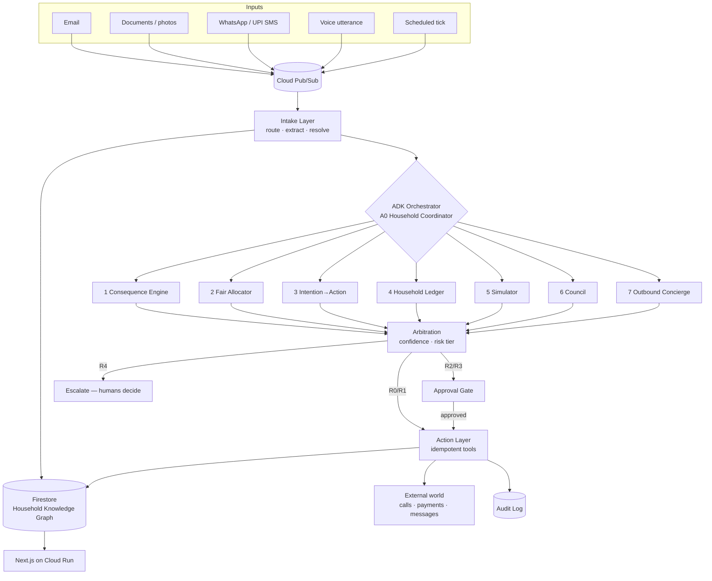
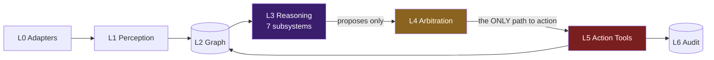
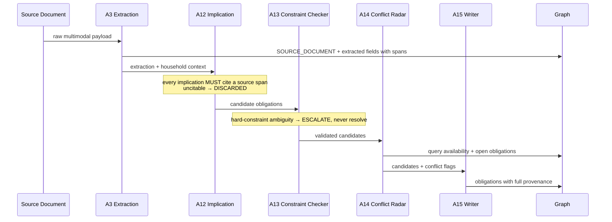
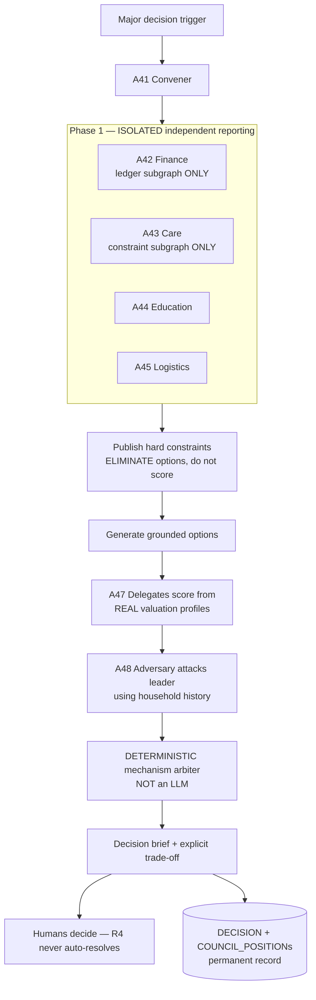
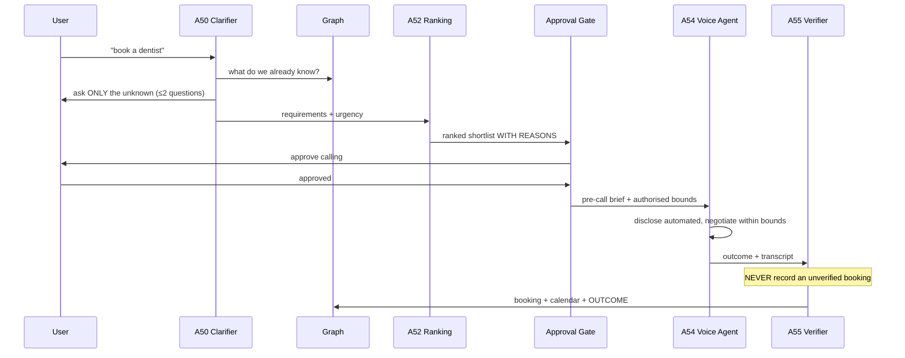
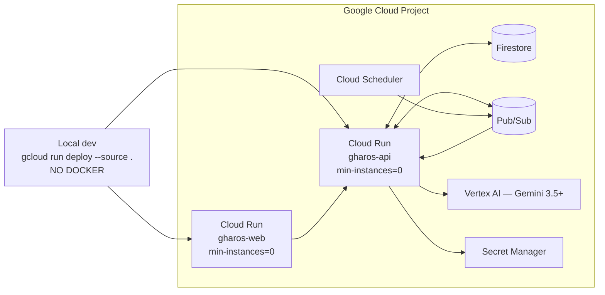

# GharOS — Phased Build Plan

**Companion document:** `GharOS_Build_Spec_v2.md` (the WHAT). This file is the HOW and the WHEN.
**Audience:** Claude Code, executing autonomously.
**Invocation:** the operator says *"start phase N"*. The roles assigned to that phase activate and begin. No further prompting should be required.

---

## 0. OPERATING PROTOCOL — READ THIS FIRST, EVERY SESSION

### 0.1 Reading order

1. Read `GharOS_Build_Spec_v2.md` **in full** before writing any code. It defines every entity, agent, tool, permission tier, and failure mode. This file references the spec; it does not repeat it.
2. Read §1–§7 of this file (team, standards, ownership, stack, structure, cost, definition of done).
3. Execute **only** the requested phase.
4. At phase end, run the **Green-Light Gate**. Do not proceed until every item passes.

### 0.2 The rule that matters most

**Phases are gated, not sequential-by-default.** A phase is complete only when its gate passes in full. If a gate item fails, fix it *inside that phase*. Never carry a failing gate item forward as "we'll fix it later" — that is exactly the technical debt this plan exists to prevent.

### 0.3 Contracts before parallelism

Every phase begins with the **Lead CTO** freezing that phase's contracts — schemas, interfaces, tool signatures, error types — into `contracts/`. Only then do staff engineers begin parallel work.

This is non-negotiable. Parallel agents that each invent their own shape for a shared object produce a reconciliation phase nobody planned for.

---

## 1. THE TEAM

Five roles. Starting a phase activates only its assigned roles.

### LEAD CTO — `@cto`
Owns architecture decisions, contract definition, cross-cutting consistency, review gates, ADRs, and the final call on any disagreement.

- **Before each phase:** freeze contracts; publish the file-ownership map for the phase.
- **During:** answer interface questions; resolve ambiguity; refuse scope drift into other phases.
- **After:** run the CTO Review Checklist; return work that fails it; write ADRs; sign the gate.

The CTO writes few production files. The CTO writes contracts, reviews, and decisions.

### E1 — PLATFORM & DATA — `@e1`
Firestore, the knowledge graph, persistence, schema, migrations, traversal, audit log, state, idempotency infrastructure, deterministic solvers.
**Owns:** `backend/app/graph/`, `backend/app/persistence/`, `backend/app/audit/`, `backend/app/solvers/`, `backend/migrations/`, `backend/seeds/`

### E2 — AGENTS & REASONING — `@e2`
ADK orchestration, all agent implementations, Gemini integration, prompts, model-tier routing, confidence scoring.
**Owns:** `backend/app/agents/`, `backend/app/reasoning/`, `backend/app/prompts/`

### E3 — INTEGRATIONS & ACTIONS — `@e3`
Tools, permission enforcement, ingestion adapters, document-type registry, Pub/Sub, Cloud Run and Scheduler infra, external APIs, voice/telephony, deployment.
**Owns:** `backend/app/tools/`, `backend/app/adapters/`, `backend/app/events/`, `backend/app/voice/`, `infra/`, `scripts/`

### E4 — FRONTEND & EXPERIENCE — `@e4`
Next.js app, design system, graph visualisation, approval UI, council and ledger surfaces, voice UI, demo surfaces.
**Owns:** `frontend/`

**CTO-only, shared:** `contracts/`, `docs/adr/`, `README.md`, `PHASES.md`, root config.

### 1.1 File ownership is hard, not advisory

An engineer **may not edit files outside their owned directories.** If E2 needs a change in `backend/app/graph/`, E2 raises it to the CTO, who either makes it or assigns it to E1.

This constraint is what makes parallel execution safe. Shared types live in `contracts/` and are written by the CTO only.

---

## 2. ENGINEERING STANDARDS — APPLY TO EVERY PHASE

**The goal is production-ready code, not a prototype that happens to run.**

### 2.1 Non-negotiable quality rules

1. **No technical debt enters a merged phase.** If a shortcut is unavoidable, it goes into `docs/DEBT.md` with an owner and a repayment phase, and the CTO must approve it. Undocumented shortcuts are rejected at review.
2. No commented-out code. Delete it; git remembers.
3. No `TODO` without an owner and a referenced issue.
4. No magic values. Named constants in a config or constants module.
5. Functions ≤ ~50 lines and files ≤ ~500 lines without a stated reason.
6. **Full type annotations.** Python `mypy --strict` clean; TypeScript `strict: true`, no `any` without a justifying comment.
7. Docstrings on every public function: purpose, params, returns, raises.
8. **Typed errors.** No bare `except:`. No swallowed exceptions. Catch to handle meaningfully or re-raise with context.
9. No secrets in code. Env vars via a single settings module.
10. Structured JSON logging. Never `print()`.

### 2.2 Architecture and design patterns

- **Hexagonal / ports-and-adapters.** Domain logic imports no framework code. Agents never import Firestore.
- **Dependency injection.** No module-level singletons holding I/O. Dependencies passed in — which is also what makes tests possible.
- **Repository pattern** for all graph access. Agents call repositories defined in `contracts/`.
- **Strategy pattern** for the document-type registry (spec §5.4). Each type is a registered strategy — never a branch in a growing `if`.
- **Command pattern** for actions. Every action is an object carrying a risk tier, an idempotency key, and an audit reference. This is what lets the approval gate be enforced in *one* place rather than scattered across call sites.
- **Result types** for expected failure paths (low confidence, escalation needed). Exceptions are for the genuinely unexpected.
- **Immutability by default** for domain objects. Graph writes create versions; they do not mutate in place.

### 2.3 Testing requirements

A phase without tests does not pass its gate.

- **Unit tests** for all domain logic and agents (model calls mocked). ≥80% coverage on `backend/app/`; **100% on anything in the money or safety path**.
- **Contract tests** for every repository and tool, proving the `contracts/` interface is honoured.
- **Integration tests** per subsystem against the Firestore emulator.
- **Golden-file tests** for extraction — the regression net for the most fragile part of the system.
- **Adversarial tests** for the Implication Agent: documents designed to tempt hallucination, asserting uncitable inferences are discarded.
- **Frontend:** design-system component tests; smoke tests for graph render and approval flow.

### 2.4 The eight safety invariants — enforced structurally, not by convention

Each must be **impossible to violate in code**, and each must have a test proving it:

1. No agent that reasons about money holds a financial tool credential.
2. Every action writes its audit record **before** execution.
3. Every derived node/edge carries provenance and a derivation tag.
4. Low-confidence outputs escalate; they never silently act.
5. Financial and irreversible actions require explicit human approval.
6. Agent-to-agent interaction is never framed or implemented as debate.
7. A failed tool call never produces a fabricated success.
8. Inbound voice confers no action capability; R3 money actions are never approved by voice alone.

**`backend/tests/test_safety_invariants.py` is created in Phase 1 and grows every phase. It is never skipped and never marked xfail.**

---

## 3. TECH STACK — FIXED

| Layer | Choice | Notes |
|---|---|---|
| Backend | **Python 3.13 + FastAPI** | async throughout, uvicorn. Migrated from 3.12 in Phase 2 — see ADR-006; Google Cloud's buildpack builder dropped 3.12 support after this table was originally written |
| Agents | **Google ADK** | mandatory requirement #2 |
| Model | **Gemini 3.5+ via Vertex AI** | mandatory requirement #1 |
| Database | **Firestore (Native)** | mandatory requirement #3 — the knowledge graph |
| Events | **Cloud Pub/Sub** | event-driven triggers |
| Compute | **Cloud Run — source deploys** | mandatory requirement #3, scale-to-zero |
| Scheduling | **Cloud Scheduler** | monthly cycles, consolidation, retries |
| Frontend | **Next.js 15 (App Router) + TypeScript** | |
| Styling | **Tailwind CSS v4** | tokens in §3.2 |
| Graph viz | **D3 force simulation** (Cytoscape.js if perf demands) | E4 decides in the viz phase, records an ADR |
| Packages | **uv** (Python), **pnpm** (Node) | |
| Quality | **ruff + mypy**, **eslint + prettier** | |
| Tests | **pytest + pytest-asyncio**, **vitest + testing-library** | |
| **NO DOCKER** | Cloud Run **source deploys** via buildpacks | `gcloud run deploy --source .` |

### 3.1 No Docker — what that means practically

Cloud Run source deploys use Google Cloud Buildpacks:
- **Python service:** `requirements.txt` at the service root (exported from uv) plus an explicit `Procfile`.
- **Next.js service:** standard `package.json` with `build` and a `start` that binds `$PORT`.

**No Dockerfile is written anywhere in this project.** If a phase appears to need one, escalate to the CTO — the answer is a buildpack configuration.

### 3.2 Design system — rich royal, light and dark

E4 owns this. Defined once in Phase 0, never re-invented per screen.

**Direction.** GharOS is a household *ledger and archive* that happens to think — the visual language should read as a well-kept record book, not a productivity SaaS dashboard. Deep lapis and antique brass on warm parchment; the same palette inverted to ink and candlelight in dark mode. Rich and royal, but archival rather than luxurious.

**Required tokens** (CSS custom properties, both themes):
- `--surface-base`, `--surface-raised`, `--surface-overlay`
- `--ink-primary`, `--ink-secondary`, `--ink-muted`
- `--royal-primary`, `--royal-deep`, `--royal-soft`
- `--accent-brass`, `--accent-brass-muted`
- `--state-success`, `--state-warning`, `--state-danger`, `--state-info`
- **Derivation colours — load-bearing, not decorative:** `--derivation-extracted`, `--derivation-inferred`, `--derivation-ambiguous`
- `--edge-conflict` — the red that matters
- Spacing, radius, elevation, motion scales

**Rules.** Both themes first-class; dark is not an inverted afterthought. WCAG AA minimum. No raw hex in components — tokens only. Motion is purposeful: the graph growing is the one place animation carries meaning. Typography: one display face with character for headings, one highly legible face for data and body.

---

## 4. REPOSITORY STRUCTURE — CREATED IN PHASE 0

```
gharos/
├── README.md                        # CTO
├── PHASES.md                        # CTO
├── GharOS_Build_Spec_v2.md          # read-only reference
├── .env.example
├── .gitignore
├── Makefile
│
├── contracts/                       # CTO ONLY — frozen interfaces
│   ├── graph_types.py               # nodes, edges, derivation tags, provenance mixin
│   ├── repositories.py              # abstract repository protocols
│   ├── tools.py                     # tool protocols + permission tiers
│   ├── agents.py                    # agent I/O contracts
│   ├── actions.py                   # Action command objects, risk tiers
│   ├── errors.py                    # typed error taxonomy
│   └── events.py                    # Pub/Sub envelopes
│
├── docs/
│   ├── adr/
│   ├── diagrams/                    # mermaid sources
│   ├── DEBT.md                      # approved, scheduled debt only
│   ├── IMPLICATION_BASELINE.md      # honest eval results
│   ├── FAIRNESS_GUARANTEE.md        # exactly what is delivered
│   └── DEPLOYMENT_PROOF.md
│
├── backend/
│   ├── pyproject.toml
│   ├── requirements.txt             # exported for buildpacks
│   ├── Procfile                     # web: uvicorn app.main:app --host 0.0.0.0 --port $PORT
│   ├── app/
│   │   ├── main.py
│   │   ├── settings.py
│   │   ├── api/
│   │   ├── graph/                   # E1
│   │   ├── persistence/             # E1
│   │   ├── audit/                   # E1
│   │   ├── solvers/                 # E1 — deterministic: fairness, arbiter, payroll, calibration
│   │   ├── agents/                  # E2
│   │   │   ├── orchestration/ intake/ graph_layer/ consequence/
│   │   │   ├── allocator/ intention/ ledger/ simulator/
│   │   │   └── council/ concierge/ voice/ crosscutting/
│   │   ├── reasoning/               # E2 — model routing, confidence, thinking tiers
│   │   ├── prompts/                 # E2 — versioned
│   │   ├── tools/                   # E3 — by permission tier
│   │   ├── adapters/                # E3 — ingestion + doc-type registry
│   │   ├── events/                  # E3
│   │   ├── voice/                   # E3
│   │   └── arbitration/             # CTO-adjudicated, E2+E3
│   ├── migrations/                  # E1
│   ├── seeds/                       # E1
│   └── tests/
│       ├── unit/ contract/ integration/ golden/ evaluation/
│       └── test_safety_invariants.py
│
├── frontend/                        # E4
│   ├── package.json  next.config.ts  tailwind.config.ts
│   ├── app/
│   ├── components/
│   │   └── design-system/ graph/ approvals/ ledger/ council/ voice/
│   ├── lib/
│   ├── styles/tokens.css
│   └── tests/
│
├── infra/                           # E3
│   ├── setup_gcp.sh  pubsub_topics.sh  scheduler_jobs.sh
│   ├── deploy_backend.sh  deploy_frontend.sh  teardown.sh
│   └── firestore.rules
│
└── scripts/
    ├── dev.sh  emulators.sh  seed_demo.sh
```

**There is no `Dockerfile` in this tree. Its absence is a gate item in Phase 2 and Phase 15.**

---

## 5. ARCHITECTURE DIAGRAMS

Mermaid sources live in `docs/diagrams/`, authored by the CTO in Phase 0. They are graded artifacts — the submission requires an architecture diagram.

### 5.1 System overview — `01-system.md`



### 5.2 Layers and the action barrier — `02-layers.md`



**The L3→L5 barrier is the architecture.** Reasoning agents hold no action credentials.

### 5.3 Consequence Engine — `03-consequence.md`



### 5.4 Council protocol — `04-council.md`



### 5.5 Outbound Concierge — `05-concierge.md`



### 5.6 Deployment — `06-deployment.md`



---

## 6. COST CONTROL AND DEPLOYMENT PROOF

### 6.1 The requirement

Per the hackathon rules, the app **need not be publicly live** at submission or judging. It must be **provably built and deployed on Google Cloud**, evidenced in the demo video and repository.

### 6.2 Cost rules — enforced from Phase 0

1. Every Cloud Run service deploys with `--min-instances=0`. Never overridden.
2. `--max-instances=2` initially, so a runaway loop cannot generate a bill.
3. **Model tier routing enforced in code** (`reasoning/model_router.py`): Flash for ingestion, normalisation, routing, classification; Pro-tier only for the named hard reasoning steps in the spec. **A Pro-tier call from an agent not on the allowlist is a test failure.**
4. Elevated thinking budgets are opt-in per agent, never global.
5. Local development uses **Firestore and Pub/Sub emulators** — no cloud spend day to day.
6. `infra/teardown.sh` scales to zero; run after every proof capture.
7. Budget alert configured in Phase 0.

### 6.3 Deployment proof checklist → `docs/DEPLOYMENT_PROOF.md`

- Cloud Run services list — both services, region, revision
- Cloud Run revision detail — successful **source** build (proving buildpacks, no Docker)
- Firestore console — real household graph documents
- Pub/Sub topics and subscriptions
- Cloud Scheduler jobs
- Vertex AI request metrics
- **Cloud Logging export of a genuine unattended overnight run with real timestamps** — the strongest single artifact; capture from a real scheduled run, not the demo
- `infra/` scripts that produced all of the above

---

## 7. DEFINITION OF DONE — EVERY PHASE

- [ ] All assigned work items complete
- [ ] `ruff check` + `mypy --strict` clean (backend)
- [ ] `eslint` + `tsc --noEmit` clean (frontend)
- [ ] All tests pass; coverage targets met
- [ ] `test_safety_invariants.py` passes, with the phase's new invariants added
- [ ] No new `docs/DEBT.md` entries without CTO approval
- [ ] `contracts/` matches implementation, proven by contract tests
- [ ] ADR written for every non-obvious decision
- [ ] Green-Light Gate demo runs end-to-end
- [ ] CTO Review Checklist signed

---

# PHASE 0 — FOUNDATION & ENVIRONMENT

**Roles:** `@cto` (lead) · `@e1` · `@e3` · `@e4`
**Goal:** repository, cloud project, design system, frozen core contracts, diagrams.

## 0.A — CTO: contracts and diagrams

Write `contracts/` in full for the graph substrate. This is the most consequential work in the project; everything downstream depends on these shapes.

- `graph_types.py` — every node and edge type from spec §5.2/§5.3 as frozen dataclasses, including the receipt/verification edges. Provenance mixin: `derivation` enum (`EXTRACTED`/`INFERRED`/`AMBIGUOUS`), `confidence`, `source_ref`, `deriving_agent`, `created_at`, `superseded_at`.
- `repositories.py` — abstract protocols. **No Firestore types leak in.**
- `errors.py` — `LowConfidenceError`, `EscalationRequired`, `ConstraintViolation`, `AmbiguousEntity`, `ToolFailure`, `ApprovalRequired`, `OutOfBounds`.
- `actions.py` — `Action` command object: risk tier R0–R4, idempotency key, audit ref, `execute()` protocol.
- `tools.py` — tool protocols annotated with permission tiers T0–T6 and T5i.
- `events.py` — Pub/Sub envelope schema.
- All six diagrams from §5 into `docs/diagrams/`.

ADRs: Firestore layout for edges; Result-vs-exception policy; prompt versioning.

## 0.B — E1: local data foundation

```bash
curl -LsSf https://astral.sh/uv/install.sh | sh
cd backend && uv init
uv add fastapi "uvicorn[standard]" google-cloud-firestore google-cloud-pubsub \
       google-cloud-aiplatform google-adk pydantic pydantic-settings structlog tenacity
uv add --dev pytest pytest-asyncio pytest-cov mypy ruff hypothesis
uv export -q --no-hashes --format requirements-txt > requirements.txt
# -q is required, not cosmetic: without it, some uv versions print a
# "Resolved N packages in Xms" progress line to STDOUT (not stderr) as the
# file's first line, which buildpacks' pip install then rejects outright as
# an invalid requirement — this broke the Phase 2 deploy in practice.
```

- `scripts/emulators.sh` — Firestore + Pub/Sub emulators
- `backend/app/settings.py` — single pydantic-settings module
- Stub repositories satisfying the contracts
- `backend/tests/test_safety_invariants.py` with all eight invariants as explicit placeholders

## 0.C — E3: cloud project and deploy path

```bash
gcloud auth login
gcloud projects create gharos-<suffix> --name="GharOS"
gcloud config set project gharos-<suffix>
gcloud services enable run.googleapis.com firestore.googleapis.com pubsub.googleapis.com \
  aiplatform.googleapis.com cloudscheduler.googleapis.com secretmanager.googleapis.com \
  cloudbuild.googleapis.com
gcloud firestore databases create --location=asia-south1
```

- `infra/setup_gcp.sh` — idempotent version of the above
- Budget alert (~$25) with 50% / 90% thresholds
- `backend/Procfile`: `web: uvicorn app.main:app --host 0.0.0.0 --port $PORT`
- `infra/deploy_backend.sh`:
  ```bash
  gcloud run deploy gharos-api --source ./backend --region asia-south1 \
    --min-instances=0 --max-instances=2 --allow-unauthenticated
  ```
- `infra/teardown.sh`

## 0.D — E4: frontend and design system

```bash
pnpm create next-app@latest frontend --typescript --tailwind --app --eslint
cd frontend && pnpm add d3 @types/d3 lucide-react next-themes
pnpm add -D vitest @testing-library/react @testing-library/jest-dom
```

- `styles/tokens.css` — full palette per §3.2, both themes, every token
- `components/design-system/` — Button, Card, Badge, Dialog, Toggle, and **DerivationBadge** (extracted/inferred/ambiguous appears everywhere)
- Theme switcher with no flash-of-wrong-theme
- `/tokens` route rendering every token in both themes — this is how the design system gets reviewed

## 🟢 GATE 0

- [ ] `contracts/` complete, importable, **no Firestore or FastAPI imports inside**
- [ ] All six diagrams committed
- [ ] `/tokens` renders correctly in both themes; contrast checked
- [ ] Emulators run locally
- [ ] Budget alert active; `teardown.sh` verified
- [ ] **No Dockerfile anywhere**
- [ ] Lint and types clean both sides

**CTO review:** do the contracts leak infrastructure types? Are tokens complete enough that no later phase needs to invent a colour?

---

# PHASE 1 — GRAPH SUBSTRATE

**Roles:** `@e1` (lead) · `@cto`
**Depends on:** 0
**Goal:** the knowledge graph is real, provenance is enforced, audit works. Nothing downstream can be trusted until this is.

## Work — E1

1. Firestore implementation of every node type (spec §5.2) and edge type (§5.3), **including** `line_item_of`, `discharges`, `verifies`, `contradicts`, `absent_from`, `substitutes`, `evidences_effort`.
2. **Provenance enforcement at the write layer.** A write missing `source_ref`, `derivation`, `confidence`, or `deriving_agent` is **rejected by the repository**. This is the system's single most important defence.
3. Versioning and supersession — writes create versions; `superseded_at` set, never overwritten.
4. All 14 traversals from spec §5.7: `neighbours`, `path`, `blast_radius`, `conflicts`, `load`, `series`, `history`, `decisions_touching`, `concession_ledger`, `unexplained`, `unverified`, `expected_but_absent`, `spend_by_category`, `effort_evidence`.
5. Audit log — append-only, with a `write_before_execute` helper making the ordering structural.
6. Idempotency store — key generation and replay detection.
7. Graph integrity checker — orphans, missing provenance, dangling edges.
8. Seed loader for demo households.

## Work — CTO

- ADR on Firestore layout and composite indexes vs a future graph-native store (spec open question #8)
- Convert invariants 2 and 3 into real passing tests

## 🟢 GATE 1

- [ ] Every node and edge type round-trips
- [ ] **A provenance-less write is impossible** — proven by hypothesis fuzz test
- [ ] All 14 traversals implemented and tested
- [ ] `unexplained(scope)` empty on seeded graph
- [ ] Audit precedes side effects — proven by test
- [ ] Same idempotency key twice → one effect
- [ ] Integrity checker clean on seed data
- [ ] ≥80% coverage on `graph/` and `persistence/`; **100% on the provenance guard**

**CTO review:** can any node be traced to its source in one call? Is the derivation tag impossible to omit?

---

# PHASE 2 — MANDATORY STACK PROOF

**Roles:** `@e3` (lead) · `@e2` · `@e4`
**Depends on:** 1
**Goal:** prove all three mandatory hackathon requirements work in deployed form, early. This is a small phase deliberately — discovering a stack problem in Phase 14 is fatal.

## Work — E3

- Deploy `gharos-api` and `gharos-web` to Cloud Run via **source deploy**
- Pub/Sub topics + push subscription to the API
- Cloud Scheduler job publishing a heartbeat event
- Secret Manager wiring
- Capture initial deployment-proof screenshots

## Work — E2

- `reasoning/model_router.py` — Flash/Pro-tier routing with an **allowlist for Pro-tier callers**
- A live Gemini 3.5+ call through Vertex AI from the deployed service
- A trivial ADK agent with one tool, deployed and invoked, proving the framework works in Cloud Run

## Work — E4

- Deployed frontend reaching the deployed API
- Health/status page showing stack connectivity

## 🟢 GATE 2

- [ ] **Requirement 1:** Gemini 3.5+ via Vertex AI responding from deployed Cloud Run — screenshotted
- [ ] **Requirement 2:** a Google ADK agent executing a tool call in deployed form — screenshotted
- [ ] **Requirement 3:** Firestore + Pub/Sub + Cloud Run + Cloud Scheduler all operating — screenshotted
- [ ] Scheduler → Pub/Sub → Cloud Run round trip completes unattended
- [ ] `gcloud run services describe` confirms `min-instances=0` on both services
- [ ] **No Dockerfile exists** — verified by `find . -name "Dockerfile"` returning nothing
- [ ] Pro-tier allowlist enforced — a non-allowlisted Pro call fails a test
- [ ] `docs/DEPLOYMENT_PROOF.md` started

**CTO review:** if the demo were tomorrow, could we prove all three requirements from what exists right now?

---

# PHASE 3 — PERCEPTION & DOCUMENT REGISTRY

**Roles:** `@e2` (lead) · `@e3` · `@e1`
**Depends on:** 2

## Work — E2 (agents)

- **A2 Intake Router** — channel/type classification, relevance
- **A3 Document Extraction** — multimodal, registry-schema-driven, field confidence, **source-region pointers**
- **A3b Line-Item Extraction** — receipts/bills, product-category normalisation
- **A3c Verification Agent** — `verifies` / `contradicts` / `absent_from`; **never silently overwrites**
- **A4 Message Normalization** — chat/SMS, code-mixed
- **A5 Entity Resolution** — cross-script aliases; **never guesses on hard-constraint-bearing entities**
- **A6 Relevance Classifier**

## Work — E3 (registry)

- **Document-type registry as strategy pattern** — all fourteen types from spec §5.4, each with schema, confidence floors, target nodes, target edges, downstream triggers
- Adapters: email, upload, chat export, SMS
- Registry-gap logging for unknown types

## Work — E1

- Source-document storage with region references

## Tests

- **Golden-file suite: ≥20 real messy documents across ≥8 registry types**
- Handwriting below floor → ambiguous + surfaced, never inferred
- आरव / Aarav / Arav → one PERSON
- Adding a new type requires no pipeline modification

## 🟢 GATE 3

- [ ] 20+ golden documents extract correctly across 8+ types
- [ ] Every field carries a source-region pointer
- [ ] Attendance register below floor surfaces the image
- [ ] A receipt produces LEDGER_EVENT + PURCHASE_ITEM with correct edges
- [ ] Planted mismatch → `contradicts` edge + escalation, **no overwrite**
- [ ] Unknown type → registry gap logged, routed to triage
- [ ] **Extraction and implication are separate agents** — code-reviewed

**CTO review:** could A3 ever infer something not literally present? If yes, reject. Is the registry genuinely open?

---

# PHASE 4 — CONSEQUENCE ENGINE

**Roles:** `@e2` (lead) · `@e1`
**Depends on:** 3

> **The highest-variance component in the project.** Its quality largely determines the outcome.

## Work — E2

- **A12 Implication Agent** — Pro-tier, elevated thinking, **mandatory source-span citation; uncitable inferences discarded, not surfaced at low confidence**
- **A13 Constraint Checker** — **hard-constraint ambiguity always escalates**
- **A14 Conflict Radar** — temporal, resource, capability, load
- **A15 Obligation Writer** — dedupe, supersession
- **A16 Constraint Learner** — confirmation-gated
- Must-start-by computed backwards through dependencies and availability

## Work — E1

- Deterministic conflict pre-pass before the reasoning pass
- Load computation queries

## The honest evaluation — `backend/tests/evaluation/implication_eval.py`

Twenty **held-out** messy documents never used for tuning. Record in `docs/IMPLICATION_BASELINE.md`:
- Obligations correctly derived (recall)
- **Obligations invented — the hallucination rate, the number that matters**
- Obligations missed
- Citation validity: does each cited span actually support the claim?

**Decision point:** if hallucination is materially high, stop and fix before Phase 5. Everything downstream assumes this agent is trustworthy. Record the number either way — it is the project's real risk signal.

## 🟢 GATE 4

- [ ] Canonical field-trip email → ≥5 implied obligations with valid citations
- [ ] Every implied obligation has a verified source span
- [ ] Uncitable inferences discarded and logged — adversarial test
- [ ] Hard-constraint violation (nut allergy vs planned lunch) detected
- [ ] Temporal collision (1:30 pickup vs 1:00 meeting) detected
- [ ] Cross-channel duplicate deduplicates; follow-up supersedes
- [ ] **`docs/IMPLICATION_BASELINE.md` written with real numbers**
- [ ] Invariants 3 and 4 pass

**CTO review:** personally read ten generated obligations against their sources. Would a family member agree each follows? Would a judge?

---

# PHASE 5 — ARBITRATION, APPROVAL & ACTION LAYER

**Roles:** `@e3` (lead) · `@e2` · `@e4` · `@cto`
**Depends on:** 4
**Goal:** the safety architecture. After this, the system can act — and can be trusted to.

## Work — CTO

Freeze the action contract before implementation: risk tiers R0–R4, permission tiers T0–T6/T5i, approval evidence-bundle shape, and the structural rule that **L3 agents hold no action credentials**.

## Work — E3

- Tool implementations by tier; **permission enforced at the tool boundary**
- **A57 Confidence Arbiter** — the only path to action
- **Approval Gate** — evidence bundles; **expiry escalates, never auto-approves**
- Idempotency on every T3+ tool
- **A58 Escalation Agent** — capability- and availability-aware routing

## Work — E2

- Standardised confidence scoring; risk-tier classification per action type

## Work — E4

- Approval queue: proposed action, reasoning, evidence, confidence, consequence-if-wrong
- Escalation surface

## 🟢 GATE 5

- [ ] **A reasoning agent cannot invoke T4/T5/T6 — proven by test, not review**
- [ ] Every action writes audit before executing
- [ ] Approval gate renders complete evidence bundles
- [ ] Expiry escalates
- [ ] Idempotency proven under forced replay
- [ ] **Tool failure surfaces as failure — never fabricated success**
- [ ] All eight invariants now real tests (6 and 8 may still be placeholders)

**CTO review:** try personally to make an agent spend money without approval. If you succeed, the phase fails.

---

# PHASE 6 — FRONTEND SHELL & GRAPH VISUALISATION

**Roles:** `@e4` (lead) · `@e1`
**Depends on:** 4
**Goal:** the demo's spine — the graph visibly assembling itself from messy input.

Built early because it drives schema decisions and is the most persuasive demo artifact.

## Work — E4

- Force-directed graph: nodes by type, **edges styled by derivation** (solid extracted / dashed inferred / dotted ambiguous), conflict edges in `--edge-conflict`
- **Live growth animation** as nodes arrive — the one place motion carries meaning
- Node inspector → provenance panel with the source region highlighted
- **Path explainer** — select a conclusion, see the walkable justification
- Filters: type, person, time window, derivation
- Performance at demo scale; ADR if switching D3 → Cytoscape

## Work — E1

- Streaming/subscription endpoint for live mutations; path query API

## 🟢 GATE 6

- [ ] Ingesting a document makes the graph **visibly grow** in real time
- [ ] Derivation tags distinguishable at a glance
- [ ] Conflict edge unmissable
- [ ] Node click → source document, region highlighted
- [ ] Path explainer produces a legible chain
- [ ] Both themes correct; no raw hex
- [ ] Smooth at 500+ nodes

**CTO review:** watching cold, is it obvious the graph is being *built*, not replayed?

---

# PHASE 7 — HOUSEHOLD LEDGER

**Roles:** `@e2` (lead) · `@e3` · `@e4`
**Depends on:** 5, 3

## Work — E2

- **A28 Reconciliation Agent — READ TOOLS ONLY**, enforced by tool registration and tested
- **A29 Leakage Detection** — usage-aware judgment, not rules
- **A30 Recovery Drafting** — per-merchant playbooks
- **A32 Dispute Branch** — presents both figures, **never chooses**
- **A34 Staff Payroll** — attendance interpretation; arithmetic in a deterministic solver

## Work — E3

- **A27 Financial Signal Ingestion**
- **A31 Follow-up / Persistence** on Cloud Scheduler
- **A33 Vendor Relations**
- Payment tool — **sandbox only**, idempotency-keyed, approval-gated

## Work — E4

- Ledger view; recovered-money counter; dispute UI; payroll review showing the register image beside the computed figure

## 🟢 GATE 7

- [ ] **A28 cannot move money — proven by test**
- [ ] Silent price hike detected from price history
- [ ] Unused service flagged with usage evidence
- [ ] Handwritten register → correct salary; low confidence → shows image
- [ ] SMS/ledger mismatch → dispute branch, no auto-resolution
- [ ] Double payment impossible under replay
- [ ] Recovered-money counter reflects real computed findings

**CTO review:** inspect A28's registered tools directly. Any write capability fails the phase.

---

# PHASE 8 — FAIR ALLOCATOR

**Roles:** `@e2` (lead) · `@e1` · `@e4`
**Depends on:** 4, 7

## Work — E2

- **A17 Interviewer** — adaptive *comparative* elicitation
- **A18 Valuation Extraction** — complaints + interviews + **observed OUTCOME history** → cardinal cost matrix
- **A19 Verifier/Explainer** — verify against an external checkable signal, not self-critique
- **A20 Renegotiation Trigger** · **A21 Load Monitor**

## Work — E1

- **Deterministic fairness solver in `solvers/` — isolated, not an LLM**
- Concession ledger; `effort_evidence` queries feeding valuations

## Work — E4

- Cost matrix visualisation — **visible and confirmable, never hidden**
- Per-person fairness explanations

## 🟢 GATE 8

- [ ] Chat export → confirmable cost matrix
- [ ] Solver deterministic; identical input → identical output
- [ ] **`docs/FAIRNESS_GUARANTEE.md` states exactly what property is delivered — no overclaiming**
- [ ] Verifier confirms the property holds
- [ ] Explanations reference that person's own valuations
- [ ] "I started night shifts" → live re-allocation
- [ ] Capability constraints enforced pre-solve

**CTO review:** does the documented guarantee exactly match the code? Any gap is an integrity problem, not a wording problem.

---

# PHASE 9 — INTENTION→ACTION CONVERTER

**Roles:** `@e2` (lead) · `@e4`
**Depends on:** 5

## Work — E2

- **A22 Intention Capture** — passive detection + stale obligations
- **A23 Blocker Diagnosis** — six-type taxonomy; **states its diagnosis so it can be corrected**
- **A24 Unblocker / Preparation**
- **A25 Window Scheduling** — person free AND counterparty open AND historically likely
- **A26 Slippage Analyst** — after N: drop / delegate / pay

## Work — E4

- Diagnosis display with correction affordance; friction profile view

## 🟢 GATE 9

- [ ] Stale obligation detected unprompted
- [ ] Blocker diagnosed to a specific type with rationale
- [ ] Information blocker → fact fetched
- [ ] Decision blocker → narrowed to binary
- [ ] Aversion blocker → modality switched
- [ ] Correction updates the friction profile
- [ ] Repeat slippage escalates with real options

---

# PHASE 10 — OUTBOUND CONCIERGE

**Roles:** `@e3` (lead) · `@e2` · `@e4`
**Depends on:** 9
**Goal:** the system acts in the outside world — the most visceral demo beat.

## Work — E2

- **A50 Requirement Clarifier** — **graph-first, ask only the unknowable**; urgency detection
- **A52 Provider Ranking** — multi-factor, **reasons exposed**
- **A53 Call Planner** — objective, authorised bounds, disclosable facts, must-not-answer list
- **A55 Confirmation Verifier** — **never record an unverified booking**

## Work — E3

- **A51 Service Discovery**
- **A54 Voice Call Agent** — realtime; **automated-assistant disclosure mandatory and non-configurable**; out-of-bounds → "I'll confirm and call back"
- **A56 Fallback Coordinator** — retry → web fallback → escalate fully prepared
- **Sandbox counterparty** for demo and tests (spec §23 — do not cold-call real businesses)

## Work — E4

- Ranked shortlist with reasons; live call status; booking confirmation

## 🟢 GATE 10

- [ ] "Book a dentist" asks ≤2 questions
- [ ] Ranking explainable — user sees why #1 is #1
- [ ] Approval fires before any call
- [ ] Disclosure on every call, cannot be disabled
- [ ] Out-of-bounds → declines, offers callback
- [ ] Slot unavailable → adapts within bounds
- [ ] **Unverified outcome never recorded — proven by test**
- [ ] Failure ladder ends in useful human escalation

**CTO review:** is there any code path writing a booking without verification? If yes, the phase fails.

---

# PHASE 11 — HOUSEHOLD SIMULATOR

**Roles:** `@e2` (lead) · `@e1` · `@e4`
**Depends on:** 8

## Work — E2

- **A35 Decision Framing** — false-binary detection
- **A36 Grounding/Research** — external data **with citations, timestamps, freshness policy**
- **A37 Path Simulator** — parallel per branch. **Parallel exploration, never debate.**
- **A38 Consistency Critic** — critiques *another agent's* output
- **A39 Calibration** — household's own variance; **thin history → says so, never fabricates precision**
- **A40 Decision Synthesizer** — trade-offs, not verdicts

## Work — E1

- `blast_radius` at decision scale; OUTCOME variance queries

## Work — E4

- Branch comparison; risk register; interrogation mode

## 🟢 GATE 11

- [ ] Every branch claim traceable to graph data or a cited source **with retrieval timestamp**
- [ ] Critic catches a planted over-optimistic assumption
- [ ] Calibration uses real variance; thin history acknowledged
- [ ] Blast radius correctly identifies breakage (board-exam year, dialysis schedule, non-transferring commitments)
- [ ] Backward mode is household-specific, not generic
- [ ] Trade-offs presented; **no verdict on family choices**

**CTO review:** pick any number in the brief and demand its source. If it cannot be produced instantly, the phase fails.

---

# PHASE 12 — HOUSEHOLD COUNCIL

**Roles:** `@e2` (lead) · `@e1` · `@e4` · `@cto`
**Depends on:** 11

> **Read spec §12.2 before writing a line.** Legitimacy depends on agents differing in *information and interest*, not opinion.

## Work — CTO

Enforce in review that **no two council agents share both tool access and objective.** Distinct T0 subgraph scopes are a registration-level constraint, tested — not a convention.

## Work — E2

- **A41 Convener** — dynamic composition
- **A42–A46 Specialists** (Finance, Care, Education, Logistics, Legal) — each queries **only** its own subgraph
- **A47 Member Delegates** — per person, carrying **real valuation profiles**
- **A48 Adversary** — attacks the leader using household history
- **A49 Recorder** — writes COUNCIL_POSITIONs; **never summarises into consensus**
- **Phase-1 isolation enforced** — specialists report before seeing any other output

## Work — E1

- **Deterministic mechanism arbiter in `solvers/`** — computes resolution from published positions and constraints
- COUNCIL_POSITION persistence; `conceded_by` edges

## Work — E4

- Council view: positions with evidence, explicit trade-off, permanent record
- Historical decision browser — "why did we buy this car?"

## 🟢 GATE 12

- [ ] **No two council agents share both tools and objective — proven by test**
- [ ] Phase-1 isolation verified — no specialist observes another's output
- [ ] **Care's hard constraint ELIMINATES options, does not score them down**
- [ ] Delegates score from real behavioural profiles
- [ ] Adversary cites actual household history
- [ ] **Resolution computed by deterministic code, not an LLM**
- [ ] R4 never auto-resolves — brief only
- [ ] Every position persists with evidence; replayable in two years
- [ ] **The word "debate" appears nowhere in code, comments, UI, or docs** — invariant 6 now passes

**CTO review:** if two specialists were swapped, would output change? If not, they are not genuinely distinct and the phase fails.

---

# PHASE 13 — VOICE & MULTILINGUAL

**Roles:** `@e3` (lead) · `@e2` · `@e4`
**Depends on:** 12

> Built late deliberately — voice is an input path onto a working pipeline. Debugging both at once is avoidable pain.

> **Test intra-sentential Hinglish ASR in the first hours of this phase.** It gates everything here (spec open question #13). If unusable out of the box, escalate to the CTO for a scope call immediately.

## Work — E3

- **A62 Voice Session Manager** — wake/PTT, barge-in, turn-taking, silence timeouts
- **A63 Speech Recognition Handler** — streaming, per-token confidence. **Forbidden from "cleaning up" transcripts into fluent monolingual text** — that destroys the code-mixing signal and hides uncertainty.
- **A66 Speaker Identification** — **unknown speaker → R0/R1 only**
- **A69 Voice Response** — TTS in four languages, pacing adaptation
- Mic/telephony wiring

## Work — E2

- **A64 Language & Script Identifier** — **per-span, not per-utterance**; Hindi/Marathi disambiguation is lexical and grammatical, **not script-based** (both use Devanagari)
- **A65 Normalisation** — transliteration, lakh/crore, spoken amounts, kinship terms. **Never discards the original.**
- **A67 Voice Intent Classifier**
- **A68 Confirmation Agent** — read-back discipline per spec §14.6

## Work — E4

- Voice surface: live transcript with per-span language tags, confirmation prompts, session state
- Per-person language profile settings

## 🟢 GATE 13

- [ ] Hinglish utterance → correct per-span language tags
- [ ] Code-mixed input drives the full obligation pipeline
- [ ] Amounts read back digit-grouped: "saade teen hazaar" → "₹3,500 — three thousand five hundred"
- [ ] Names read back with relationship
- [ ] **Voice alone cannot approve R3 — proven by test (invariant 8)**
- [ ] Silence or ambiguity never counts as approval
- [ ] Unknown speaker restricted correctly
- [ ] Original-language text always retained
- [ ] Marathi and Spanish function at demonstration depth
- [ ] Elder-mode pacing works

**CTO review:** confirm the depth split — recommended English + Hinglish at depth, Marathi + Spanish as breadth. Two excellent beats beat four shaky ones.

---

# PHASE 14 — CONSOLIDATION, PATTERNS & OBSERVABILITY

**Roles:** `@e1` (lead) · `@e3` · `@e2`
**Depends on:** 13

## Work — E1

- **A10 Pattern Miner** — OUTCOME regularities → PATTERN nodes, support threshold enforced
- **A11 Graph Maintainer** — supersession, staleness, orphans. **Never prunes DECISION, OUTCOME, provenance, or hard constraints.**
- Memory consolidation service, off-peak

## Work — E3

- Cloud Scheduler jobs: consolidation, follow-ups, monthly cycles
- **A genuine unattended overnight run producing real Cloud Logging timestamps** — required demo artifact

## Work — E2

- Constraint promotion from repeated signals, confirmation-gated
- Vendor reliability scoring

## 🟢 GATE 14

- [ ] Consolidation runs on schedule with no human involvement
- [ ] Pattern mining produces ≥1 non-obvious correct pattern from seeded history
- [ ] Protected node types provably never pruned
- [ ] **Real overnight run captured in Cloud Logging with genuine timestamps**
- [ ] Full trace available for any agent invocation
- [ ] Any node's provenance chain queryable end-to-end

---

# PHASE 14.5 — INGESTION CONNECTORS & END-TO-END WIRE

**Roles:** `@e3` (lead) · `@e2` · `@e4` · `@cto`
**Depends on:** 14
**Inserted:** 2026-08-29, operator direction — a real, triggerable ingestion path plus the first live raw-input-to-graph wire (DEBT-009's repayment). Numbered 14.5 rather than renumbering so existing "Phase 15" references (ADRs, `docs/DEBT.md`, `docs/DEPLOYMENT_PROOF.md`, code comments) stay accurate; Demo Hardening remains Phase 15.

**Goal:** turn ingestion from "parsers that exist but nothing calls" into a path a household member actually triggers — "scan my Gmail and Outlook", by text or by voice — reading the last 24 hours of mail through official OAuth APIs, plus a file/Drive picker, plus the orchestrator that finally connects the Phase 3 stages end to end. Scope is deliberately narrow.

**Explicitly out of scope** (stated so the write-up can't imply otherwise): any local-filesystem, Apple Photos, iMessage, or WhatsApp read. A deployed web app cannot reach those; a native desktop companion is the only route and is a post-submission roadmap item, not a claimed capability. Google Photos is Picker-only (no library sweep). Google restricted scopes (`gmail.readonly`, `drive.readonly`) run in OAuth **test mode** for the demo — a real, documented limitation.

## Work — CTO (contract freeze first)

- `contracts/` additions, frozen before E2/E3 start:
  - `SourceConnector` protocol — `fetch_since(window: timedelta) -> list[RawIntakePayload]`, implemented per provider.
  - `IngestionRequest` / `IngestionRunResult` — the run's input and its honest per-document outcome record (counts, per-doc status, registry gaps, errors; never a silent partial success).
  - `OAuthCredential` record — provider, granted scopes, principal, refresh-token **reference** only. The token itself lives in Secret Manager, never in Firestore, never passed to a reasoning agent (spec §23).
- **ADR — OAuth in a backend-only architecture:** Authorization Code + PKCE; consent-start and callback are FastAPI routes; refresh tokens in Secret Manager keyed by principal; access tokens held in memory for the run only, never persisted.
- **ADR — the ingestion orchestrator boundary:** one entry point (`POST /ingest`), one path (`SourceConnector`/adapter → A2 route → A3/A3b/A3c extract → A5 entity resolution → strategy `map_to_graph` → `GraphWriter`), idempotent per `SourceDocument` content hash so a re-scan of the same window writes nothing new.

## Work — E3 (lead)

- **`GmailConnector(SourceConnector)`** — OAuth consent + callback routes; `users.messages.list` with `newer_than:1d` (or an explicit `after:` epoch); `users.messages.get` per id; MIME → the `{headers, body}` shape `email_adapter.py` already consumes; token refresh, quota backoff.
- **`OutlookConnector(SourceConnector)`** — Microsoft Graph OAuth; `GET /me/messages?$filter=receivedDateTime ge <ISO>&$select=...`; Graph JSON → the same adapter shape.
- **File / Drive picker ingestion** — a `POST /ingest` multipart path for drag-dropped images/PDFs (reusing `document_upload_adapter.py`), and a Google Picker (`drive.file` scope, no verification) for choosing specific Drive files. No whole-Drive or Photos-library enumeration.
- **The end-to-end orchestrator** (`backend/app/pipelines/ingestion_orchestrator.py`) — the single wire from `RawIntakePayload` to committed graph nodes: idempotent per content hash, structured-logged per stage, returning a real `IngestionRunResult`. This is DEBT-009's actual code.
- Wire "scan my mailbox" as a real trigger from both the text command and the Phase 13 voice path.

## Work — E2

- A2 Intake Router — confirm it routes a real Gmail/Outlook message end to end (channel `email`), no new classification branch.
- A67 Voice Intent Classifier — add an `ingest.scan_mailbox` intent (enumerated, deterministic check independent of the LLM call, mirroring A68's pattern), routed to the orchestrator, **never** to an action tool.
- Run A3 extraction against real (not golden-file) mail bodies; write a short honesty note comparing real-world extraction quality to the golden-file baseline.

## Work — E4

- An **Ingestion / Connections** surface — connect/disconnect Gmail and Outlook (OAuth status, last-scan time, granted scopes shown plainly), a "Scan last 24 hours" button, a drag-drop zone for images/PDFs, the Drive picker.
- A live ingestion-run view — per-document status as the orchestrator processes, each new node linked into the graph view. Reuses `/graph/stream`, no new endpoint.
- The voice path surfaces the same run view when triggered by "scan my Gmail".
- Both themes.

## 🟢 GATE 14.5

- [ ] A real Gmail account connects via OAuth and "scan last 24 hours" ingests real messages into the graph, live
- [ ] The same works for a real Outlook account via Microsoft Graph
- [ ] "Scan my Gmail" spoken aloud triggers the identical path (A67 → orchestrator), routed to ingestion, never to an action
- [ ] A dragged-in receipt image and a picked Drive PDF both reach the graph through the one `POST /ingest` wire
- [ ] Re-scanning the same 24-hour window writes zero new nodes (idempotent per content hash)
- [ ] OAuth tokens live in Secret Manager, never in Firestore, never passed to a reasoning agent — proven by test
- [ ] `IngestionRunResult` reports every per-document outcome; a failed extraction is a visible failure, never a silent drop
- [ ] Provenance on every node the wire produces (invariant 3): SOURCE_DOCUMENT → extracted fields → nodes, queryable end to end
- [ ] **DEBT-009 struck** — a genuine raw-document-to-graph orchestrator exists and runs live

**CTO review:** read the graph directly and confirm a real message actually landed as a real node — do not trust the run report. Confirm the OAuth test-mode limitation and the "no local-filesystem / Photos / WhatsApp / iMessage" boundary are stated plainly in the submission write-up, not implied away.

---

# PHASE 15 — DEMO HARDENING & DEPLOYMENT PROOF

**Roles:** all five
**Depends on:** 14

## Work — CTO

- Final pass on all eight invariants
- `docs/DEBT.md` reviewed; unacceptable items repaid now
- Diagrams finalised for submission
- **Write-up honesty pass:** be precise about the fairness guarantee, the ingestion limitations (no official WhatsApp/UPI personal-data API), the sandboxed call counterparty, and the synthetic data. **Overclaiming discredits everything else.**

## Work — E1

- Full demo seed: household, constraints, 8–12 ugly documents, three months of financial signals, **sufficient OUTCOME history for calibration**, and the engineered verification receipt (discharges + substitutes + missing constraint item)
- Clean reset script

## Work — E2

- Deterministic behaviour on the demo path; the exception beat must fire reliably
- Prompt versions pinned

## Work — E3

- Final deploys; `docs/DEPLOYMENT_PROOF.md` assembled per §6.3
- Flaky external calls cached or sandboxed
- `teardown.sh` after proof capture
- **Verify no Dockerfile exists**

## Work — E4

- Demo surfaces polished in both themes
- Graph growth animation timed to the script
- Backup recording captured

## Rehearsal — mandatory, ≥3 full runs

Per spec §24: problem → trigger → autonomous execution + graph growth → outbound call → voice beat (20s, at 2:20) → council → live exception → outcome → Google Cloud proof.

Log every break point and fix it. **The exception beat must be deterministic.**

## 🟢 GATE 15

- [ ] Full 4-minute demo runs live, end-to-end, three times without intervention
- [ ] All three mandatory requirements visibly proven on camera
- [ ] `docs/DEPLOYMENT_PROOF.md` complete, including the real overnight Cloud Logging run
- [ ] **No Dockerfile in the repository**
- [ ] All eight safety invariants pass
- [ ] `docs/DEBT.md` empty or fully justified
- [ ] README enables clean-machine reproduction
- [ ] Backup recording exists
- [ ] Services scaled to zero after capture
- [ ] Submission architecture diagram matches the built system

**CTO final review:** does the submission claim anything the code does not do? Remove every such claim. Accuracy is worth more than impressiveness.

---

## APPENDIX A — PHASE / ROLE MATRIX

| Phase | CTO | E1 Platform | E2 Agents | E3 Integrations | E4 Frontend |
|---|:---:|:---:|:---:|:---:|:---:|
| 0 Foundation | **L** | ● | | ● | ● |
| 1 Graph substrate | ● | **L** | | | |
| 2 Mandatory stack proof | | | ● | **L** | ● |
| 3 Perception + registry | ● | ● | **L** | ● | |
| 4 Consequence Engine | ● | ● | **L** | | |
| 5 Arbitration + action | ● | | ● | **L** | ● |
| 6 Frontend + graph viz | | ● | | | **L** |
| 7 Household Ledger | | | **L** | ● | ● |
| 8 Fair Allocator | ● | ● | **L** | | ● |
| 9 Intention→Action | | | **L** | | ● |
| 10 Outbound Concierge | | | ● | **L** | ● |
| 11 Simulator | ● | ● | **L** | | ● |
| 12 Council | ● | ● | **L** | | ● |
| 13 Voice + multilingual | ● | | ● | **L** | ● |
| 14 Consolidation | | **L** | ● | ● | |
| 14.5 Ingestion connectors | ● | | ● | **L** | ● |
| 15 Demo hardening | **L** | ● | ● | ● | ● |

**L** = lead · ● = contributing

## APPENDIX B — SAFETY INVARIANT SCHEDULE

| # | Invariant | Introduced | Enforced by |
|---|---|---|---|
| 3 | Provenance on every node/edge | Phase 1 | Repository write guard |
| 2 | Audit before execute | Phase 1 | `write_before_execute` |
| 4 | Low confidence escalates | Phase 4 | Confidence Arbiter |
| 1 | Money reasoners hold no money tools | Phase 5 | Tool registration |
| 5 | Financial/irreversible need approval | Phase 5 | Approval Gate |
| 7 | No fabricated tool success | Phase 5 | Tool error contract |
| 6 | No debate framing | Phase 12 | Code review + lint rule |
| 8 | Voice confers no action capability | Phase 13 | Voice intent routing |

## APPENDIX C — MANDATORY REQUIREMENT TRACEABILITY

| Requirement | Satisfied by | Proven in |
|---|---|---|
| **1. Gemini 3.5+ via Gemini API or Vertex AI** | All reasoning agents via Vertex AI; Flash/Pro-tier routing | Phase 2, re-proven Phase 15 |
| **2. A Google Agent Framework** | Google ADK — orchestration, sequential/parallel/loop patterns, tool isolation, callbacks for approval gates | Phase 2, deepened every agent phase |
| **3. A Google Cloud infrastructure service** | Cloud Run (both services, source deploys, min-instances=0), Firestore (the graph), Pub/Sub (events), Cloud Scheduler (cycles) | Phase 2, re-proven Phase 15 |
| **Deployment proof (not live at judging)** | Console screenshots, source-build revision detail, real overnight Cloud Logging run, `infra/` scripts | Phase 15 → `docs/DEPLOYMENT_PROOF.md` |

## APPENDIX D — STANDING RULES

1. Read the spec before coding. This file is the plan; the spec is the truth.
2. Never start a phase whose dependencies have not passed their gate.
3. Never edit outside your owned directories.
4. Contracts change only via the CTO.
5. **No Docker. Ever.**
6. Never set `min-instances` above 0.
7. Never say "debate."
8. Never fabricate a success.
9. On a safety path, when torn between fast and correct — ship correct.
10. If a gate item cannot be met, escalate to the CTO. Never silently downgrade it.

---

*End of phased build plan.*
