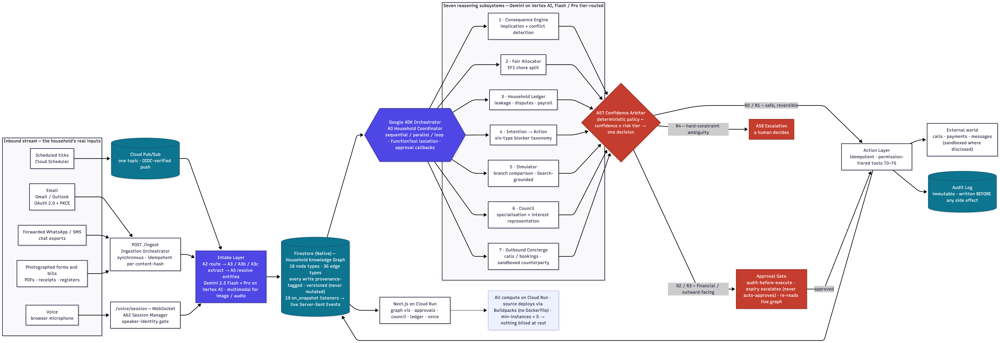
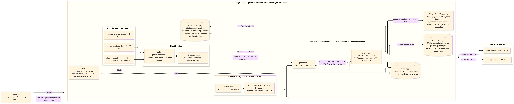
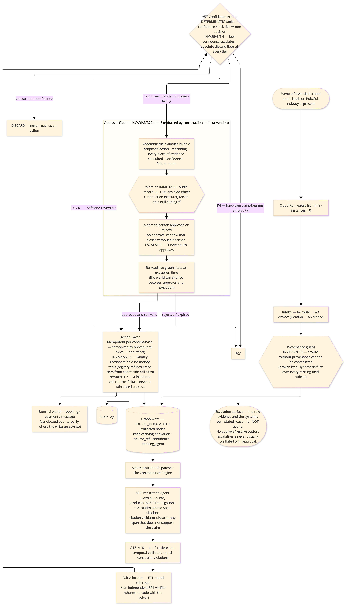
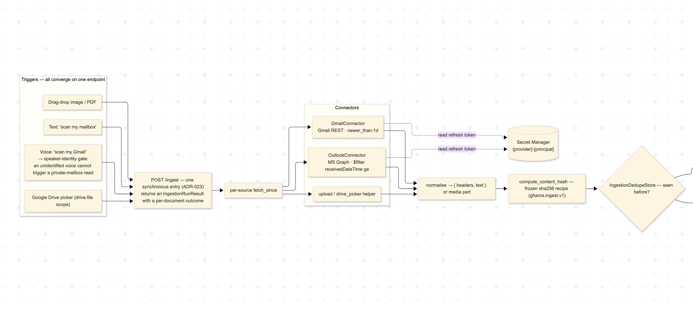
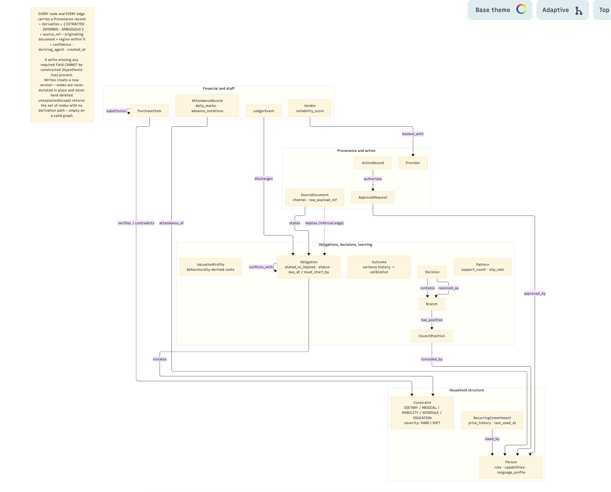
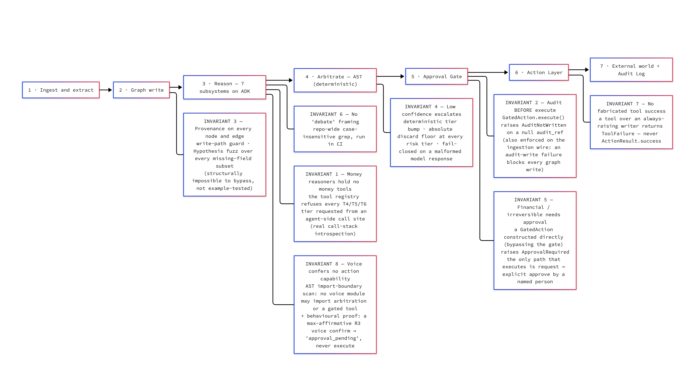

# GharOS

**An autonomous household operating system.**

> Nobody asked it to do anything. GharOS reads your household's inbox, works out what each message *implies*, catches the conflicts, does the safe parts, and leaves you only the real decisions.

*(**ghar** — घर, from Sanskrit *gṛha* — is Hindi for "home". GharOS is, literally, an operating system for one.)*

Built for the Google **"All Things Agentic"** hackathon — Taskmaster track. Single household, single-tenant. Every capability anchors to a reasoning step a script cannot perform.

<sub>**2,022** backend tests · `mypy --strict` clean on **450** files · **799** frontend tests · **8/8** safety invariants · **~23** ADRs · **no Dockerfile anywhere** · `min-instances = 0` · a real unattended overnight run in Cloud Logging</sub>

---

## Table of contents

- [The problem](#the-problem)
- [What GharOS is](#what-gharos-is)
- [Architecture](#architecture)
- [The Google Cloud stack — and why each piece](#the-google-cloud-stack--and-why-each-piece)
- [The reasoning pipeline](#the-reasoning-pipeline)
- [The Household Knowledge Graph](#the-household-knowledge-graph)
- [Safety](#safety)
- [Tech stack](#tech-stack)
- [Testing & verification](#testing--verification)
- [Architectural discipline](#architectural-discipline)
- [Repository layout](#repository-layout)
- [Running it locally](#running-it-locally)
- [Running the tests](#running-the-tests)
- [Deploying to Google Cloud](#deploying-to-google-cloud)
- [What's real, what isn't](#whats-real-what-isnt)
- [Status & roadmap](#status--roadmap)
- [Further reading](#further-reading)

---

## The problem

There is a job in every household that has no name, no job description, and — usually — one unpaid person doing all of it.

In 2019 the sociologist **Allison Daminger** studied 35 couples and split "housework" into four verbs: **anticipate** (noticing a need before it's urgent), **identify** (working out the options), **decide** (choosing), and **monitor** (checking it happened). Her finding: the *doing* gets shared, because it's visible. But **anticipation and monitoring are done alone, by one person, in almost every couple** — because there is nothing to point at. The person holding the entire live state of a household in their working memory is doing the most cognitively expensive part of the work, and it does not read as work to anyone.

The OECD's 2024 time-use data puts women's unpaid work at ~4 hours a day, roughly twice men's. A 2026 diary study (*Cognitive Research: Principles and Implications*) found **forgetting explains only ~10–14% of unfulfilled daily intentions** — the rest is *friction*: the thing was remembered and still didn't happen, because at the moment of action there was a small obstacle.

Every product in the productivity category automates the cheap, visible verbs and leaves the expensive, invisible ones exactly where they were:

| Tool | Which of the four verbs it automates | What it still leaves to you |
|---|---|---|
| **To-do apps** | none | You still have to *notice* the field-trip email implies five things, then type them in |
| **Calendars** | an artifact of *decide* | They record a choice; they don't flag a 1:30-vs-1:00 collision you didn't manually enter |
| **Budgeting apps** | *monitor*, after the fact | They chart the subscription you forgot; they won't cancel it |
| **AI-assistant chatbots** | the typing | You must *already have noticed the thing* before you open the app |

**GharOS is the thing that does the noticing.** It reads the same messy inbox a family reads, works out what each item *implies*, does the parts that are safe to do without asking, and hands a person back only the decisions that are genuinely theirs.

---

## What GharOS is

A **single-household, event-driven autonomous system.** It ingests the family's real multi-channel stream, turns every item into a node in a **provenance-tagged knowledge graph**, reasons about what each item *implies*, assigns the resulting obligations fairly, monitors them, watches the financial surface continuously, executes real-world actions from **behind a human approval gate**, and convenes an internal council of specialised sub-agents when a decision is genuinely hard.

The load-bearing design decision: **conversation is an input surface, not the product.** The primary loop runs with **nobody present** — GharOS wakes on an event (a forwarded email, a 3 a.m. scheduler tick), reasons, acts within its authority, and leaves the rest for a person. Voice enters the *same* pipeline as an email.

### The demo, beat by beat

| Beat | What happens |
|---|---|
| **Trigger** | A chaotic school email lands on Pub/Sub. Nobody asked GharOS to do anything |
| **Graph grows live** | Extraction runs; the knowledge graph assembles itself on screen — **6 obligations, 5 of them *implied*** (nut-free lunch inferred from a medical constraint × the canteen menu; 1:30 pickup inferred from the trip schedule), each with a provenance edge back to the exact sentence |
| **Conflict** | A red edge lights up: the 1:30 pickup collides with a 1:00 meeting; the nut allergy violates Tuesday's menu |
| **Allocation** | The Fair Allocator assigns each obligation an owner with a one-line reason |
| **Outbound call** | "Book a dentist" → 2 clarifying questions (not 20) → ranked shortlist → **approval gate** → live sandboxed transcript → verified booking |
| **Voice (20 s)** | A code-mixed Hindi-English sentence, transcribed with **per-span** language tags, grows the graph, replies in register |
| **Council** | The "second car" decision — specialists on disjoint data, a hard constraint that *eliminates* options, conflicting delegate scores, an Adversary, a deterministic trade-off, who conceded |
| **Exception** | An ambiguous child name that carries a hard constraint. GharOS does **not** guess — it escalates with the raw image and its reasoning. *Knowing when not to act is the point* |
| **Cloud proof** | Pub/Sub → ADK on Cloud Run → Firestore mutation → audit trail with **real timestamps from a genuine unattended overnight run** |

---

## Architecture



*All seven diagrams (with `.mmd` sources) are in [`docs/architecture/`](docs/architecture/).*

Every inbound signal, whatever the channel, is normalised by one intake layer and lands in one graph — but there are **three deliberate entry styles**:

- **Async events + the heartbeat** arrive through **Cloud Pub/Sub** and wake the service with nobody present. This is the autonomy proof.
- **On-demand ingestion** ("scan my Gmail") is a synchronous, idempotent **`POST /ingest`** into the Ingestion Orchestrator.
- **Voice** is a WebSocket session that produces the same source documents as an email.

The seven subsystems are reasoning consumers of the shared graph. **Arbitration (A57) is the single chokepoint** between reasoning and action; reasoning agents hold no action credentials.

### The seven subsystems

| # | Subsystem | What it does | Notable property |
|---|---|---|---|
| 1 | **Consequence Engine** | Reads a document and produces *implied* obligations that were never stated, each with a verbatim source-span citation; detects conflicts | A citation validator discards any span that doesn't support the claim |
| 2 | **Fair Allocator** | Splits shared chores against a household cost matrix you can see and correct | Provable **EF1** guarantee; an independent verifier shares no code with the solver |
| 3 | **Household Ledger** | Continuous financial watch — silent price hikes, unused services, duplicate charges; drafts recovery; staff payroll from a photographed register | The reconciliation agent is read-only *by construction* |
| 4 | **Intention → Action** | Diagnoses a blocked task to one of six specific blocker types; unblocks in a way that matches the real cause | "Forgetting is 10–14%; friction is the rest" is the design premise |
| 5 | **Household Simulator** | Branch comparison for live decisions; every projected impact traces to graph data or a **Google-Search-grounded** citation with a retrieval timestamp | A fabricated citation is impossible — only the grounding tool produces them |
| 6 | **Household Council** | Convenes specialists on disjoint graph scopes + delegates with conflicting interests + an Adversary; a **deterministic** arbiter publishes the trade-off | Mechanism design, **not** multi-agent debate (enforced by a repo-wide grep in CI) |
| 7 | **Outbound Concierge** | Places real multi-turn calls (to a sandboxed counterparty), ranks providers with reasons, books only after independent verification | Mandatory automated-disclosure turn — no code path skips it |

### The single door

Between reasoning and action there is exactly one path: the **A57 Confidence Arbiter** (a deterministic table — confidence × risk tier → decision; it cannot be forgotten or argued out of its verdict), then the **Approval Gate**, which:

1. writes an immutable **audit record before any side effect** — `execute()` raises on a null `audit_ref`;
2. **escalates on expiry**, never auto-approves;
3. **re-reads live graph state** at execution time (the world can change between approval and execution).

### The fairness guarantee, stated exactly

The Fair Allocator delivers **EF1 (envy-free up to one item) for chores under additive cost valuations**, by fixed-order round-robin picking: for every ordered pair of people `(i, j)`, there exists one task `g` in person `i`'s bundle such that `cost_i(bundle_i \ {g}) ≤ cost_i(bundle_j)`.

It **does not** claim Pareto-optimality or Maximum Nash Welfare (MNW's combined result is for *goods*, not chores), and there is **no algorithmic novelty** — round-robin is textbook. The contribution is the *input pipeline*: the auto-derived task list and behaviourally-derived cost valuations.

### The Council's arbiter

Minimises the maximum regret any single person could feel, with a leximin tie-break (Savage, 1951):

```
o* = argmin over options o of ( max over people p of ( cost_p(o) - min over options o' of cost_p(o') ) )
```

Specialists read **disjoint** graph scopes in isolation (anti-anchoring by construction). Hard constraints *eliminate* options rather than scoring them down. It is mechanism design, not debate. See [`docs/adr/019-household-council-contracts.md`](docs/adr/019-household-council-contracts.md).

### Model-tier routing

Every reasoning call is routed through one `ModelRouter`:

- **Gemini 3.5 Flash** for ingestion, normalisation, routing, classification;
- **Gemini 3.5 Pro** only for the named hard-reasoning agents on an explicit allowlist (implication, the Council specialists and arbiter, the concierge clarifiers, backward-mode simulation).

A Pro-tier call from a non-allowlisted agent is a **test failure**. Pro-tier resolves through Vertex AI's `global` location (`gemini-3.5-pro` 404s regionally in `asia-south1` — [ADR-010](docs/adr/010-per-tier-vertex-ai-location.md)).

---

## The Google Cloud stack — and why each piece

An autonomous household system has an unusual shape: it must wake on its own with nobody watching, be cheap enough to leave running for months, keep a live walkable record of everything, and never quietly do the wrong thing. Google Cloud had a primitive for each property, and they compose.



| Service | What GharOS uses it for | Why it's the right primitive |
|---|---|---|
| **Vertex AI + Gemini 3.5** | Every reasoning call. **Flash** for routing/classification; **Pro** for allowlisted hard reasoning. Multimodal (image + audio) in the same call shape. Native TTS in 4 languages. Google Search grounding as a built-in tool | Collapses text + vision + audio + TTS + web-grounding into one IAM-governed, regionally-addressable surface. Tier and region are config knobs |
| **Google ADK** | The agent topology — A0 orchestrating 7 subsystems; sequential/parallel/loop composition; `FunctionTool` isolation; callbacks as the approval hook | Makes the safe thing the default: an agent is *constructed* with a tool set and physically cannot call one it wasn't given |
| **Firestore (Native)** | The knowledge graph, audit log, dedupe & idempotency stores. Node-per-collection + flat `edges`. Versioned writes. **19 `on_snapshot` listeners** fanned out over Server-Sent Events | Versioned history falls out of the document model → "why did we decide this two years ago?" is a real feature. Real-time listeners *are* the live graph stream — no polling |
| **Cloud Pub/Sub** | One topic; every inbound signal enters through the same intake. Push subscriptions with **OIDC verification** | Makes "the loop runs with nobody present" literally true. At-least-once delivery is safe because every path is idempotent per content hash |
| **Cloud Run** | Both services. **Source deploys via Buildpacks — no Dockerfile anywhere.** `min-instances = 0` | An autonomous system is idle 99% of the time; at min=0 it bills **nothing** at rest. A ~16-hour unattended overnight run cost effectively zero. HTTP-native → the Pub/Sub push model just works |
| **Cloud Scheduler** | 3 managed cron jobs: heartbeat (*/5 min), nightly consolidation (03:00 IST), follow-up sweep (07:00/19:00) → Pub/Sub → Cloud Run | No always-on worker to keep alive. The Cloud Logging trace of a 03:00 firing with nobody present is the autonomy proof |
| **Secret Manager** | OAuth refresh tokens, keyed `{provider}:{principal}` — never in Firestore, never in an agent input | A separate IAM-scoped surface; an **AST test** fails if any agent module can even *import* it |
| **Cloud Logging** | The receipts — the overnight run, per-revision build provenance, `min-instances=0` holding | Exported log lines with real timestamps, not dashboard screenshots. See [`docs/DEPLOYMENT_PROOF.md`](docs/DEPLOYMENT_PROOF.md) |

**The whole thing composes:** an event lands on Pub/Sub → wakes a Cloud Run service that is otherwise scaled to zero → reasons using Gemini on Vertex AI orchestrated by ADK → writes a provenance-tagged fact to Firestore → whose `on_snapshot` listeners stream it live to a Cloud Run frontend → with an immutable audit entry and a Cloud Logging trail → then it all goes quiet and stops billing until the next event.

---

## The reasoning pipeline

### Event → Action (the safety path)



One worked path — a school email lands on Pub/Sub with nobody present — traced to a real action, with each of the eight safety invariants marked at the point it bites. The load-bearing guarantee is not "the model never errs" — it is **"the system never *acts* on an error"**, a property of the shape, not the model.

### Ingestion (raw input → provenance-linked nodes)



One synchronous `POST /ingest` entry, one fixed pipeline: per-source fetch → normalise → **content-hash dedupe** (a re-scan of the same window writes zero new nodes) → raw-payload store → **audit append before any graph write** → route → extract (Gemini, multimodal for photographed forms) → resolve entities → the registered extraction strategy → the provenance-guarded writer. Every terminal state — `INGESTED`, `DUPLICATE_SKIPPED`, `EXTRACTION_FAILED`, `REGISTRY_GAP`, `ENTITY_RESOLUTION_ESCALATED` — is a visible outcome, never a silent drop. Gmail/Outlook connect through real OAuth 2.0 (Authorization Code + PKCE); refresh tokens live in Secret Manager. See [ADR-022](docs/adr/022-oauth-in-a-backend-only-architecture.md) and [ADR-023](docs/adr/023-ingestion-orchestrator-boundary.md).

---

## The Household Knowledge Graph



**18 node types, 36 edge types.** The single rule the whole system rests on: **every node and every edge carries provenance, and a write without it cannot be constructed.**

Provenance = a `derivation` (`EXTRACTED` / `INFERRED` / `AMBIGUOUS`), a `source_ref` (originating document + region within it), a `confidence`, the deriving agent, a timestamp. Proven by a **Hypothesis property-based test** that generates every possible subset of missing provenance fields and fires each at the real emulator-backed writer, asserting rejection every time. Writes create a new version — nodes are never mutated in place and never hard-deleted. A query, `unexplained(scope)`, returns nodes with no derivation path; on a valid graph it returns empty, and that is checked on every seed load.

This is what makes every downstream claim honest: when GharOS says "the nut allergy conflicts with Tuesday's menu," you can click through to the exact sentence in the canteen PDF and the exact field in the medical record.

---

## Safety



Eight invariants, each with a real, passing, **never-skipped** test, each enforced **by construction**:

| # | Invariant | Enforced by |
|---|---|---|
| 1 | Money reasoners hold no money tools | Registry refuses every gated tier from an agent-side call site (real call-stack introspection) |
| 2 | Audit before execute | `GatedAction.execute()` raises `AuditNotWritten` on a null `audit_ref` |
| 3 | Provenance on every node & edge | Write-path guard + Hypothesis fuzz over every missing-field subset |
| 4 | Low confidence escalates | Deterministic tier bump; absolute discard floor at every tier; fail-closed on a malformed response |
| 5 | Financial / irreversible needs approval | A `GatedAction` built directly (bypassing the gate) raises `ApprovalRequired` |
| 6 | No "debate" framing | Repo-wide case-insensitive grep, in CI |
| 7 | No fabricated tool success | A tool over an always-raising writer returns `ToolFailure`, never `success` |
| 8 | Voice confers no action capability | AST import-boundary scan + a behavioural proof: a max-affirmative R3 voice confirm → `approval_pending`, never execute |

`backend/tests/test_safety_invariants.py` → **27 tests, 0 skipped, 0 xfail.**

---

## Tech stack

| Layer | Choice |
|---|---|
| Backend | Python 3.13 · FastAPI · Google ADK · `uv` · `pydantic` |
| Reasoning | Gemini 3.5 Flash + Pro via **Vertex AI** · native TTS · Google Search grounding |
| Data | **Firestore** (Native) · **Cloud Pub/Sub** |
| Runtime | **Cloud Run** (source deploys, `min-instances=0`) · **Cloud Scheduler** · **Secret Manager** · **Cloud Logging** · Cloud Build + Buildpacks |
| Frontend | Next.js 16 · TypeScript · Tailwind CSS v4 · canvas-rendered D3 force graph · `pnpm` |
| Quality | `ruff` + `mypy --strict` · `eslint` + `tsc` · `pytest` (+ Hypothesis) + `vitest` |
| Transport | HTTP · Server-Sent Events (live graph) · WebSocket (voice) |

---

## Testing & verification

| Suite | Files | Tests | Result | Static analysis |
|---|---|---|---|---|
| **Backend** — `pytest`, against a live Firestore emulator (not mocks) | — | **2,022 passed** · 12 skipped\* · **0 failed** | `mypy --strict` clean on **450** files · `ruff` + `ruff format` clean on 510 files |
| **Frontend** — `vitest` / jsdom | **120** | **799 passed** · **0 failed** | `eslint` clean · `tsc --noEmit` clean · `next build` clean, all **15** routes |
| **Safety invariants** — `test_safety_invariants.py` | 1 | **27 passed** · **0 skipped · 0 xfail** | every invariant enforced by construction |

<sub>\*the 12 skipped backend tests are `live_gcp`-marked — real Vertex AI / Secret Manager / TTS network calls — skipped by design unless `GHAROS_RUN_LIVE_GCP_TESTS=1`.</sub>

**What the suites exercise** (all against real infrastructure — the Firestore emulator, real AST scans, real greps):

| Area | Coverage |
|---|---|
| Graph substrate | All 18 node types + Edge round-trip · all 14 graph traversals · the provenance guard via a Hypothesis fuzz over every missing-field subset · versioned writes · idempotency with a simulated-restart replay · the integrity checker on seed data |
| Perception & registry | 14 `ExtractionStrategy` implementations · a **20-document golden-file suite** across all 14 document types · live-Gemini intake tests |
| Consequence Engine | A12–A16 · the citation validator · the **20-held-out-document hand-scored evaluation** (recall / hallucination / citation validity, v1 vs v2) |
| Arbitration & action | A57 Confidence Arbiter (hard-constraint floor, tier downgrade with no model call, discard floor at every tier, fail-closed on malformed) · the Approval Gate (audit-before-execute, expiry escalates, live re-read) · tool permission tiers via call-stack introspection · forced-replay idempotency on every T3+ tool |
| Graph API & live stream | `/graph/snapshot` · `/graph/stream` real SSE off 17 Firestore listeners · the justification path-explainer · "no replay" proven by construction |
| The 7 subsystems | Every agent A10–A69 tested — Ledger (A28 read-only, proven adversarially) · Fair Allocator (an independent EF1 verifier sharing no code with the solver) · Concierge (A55 two-layer verification that can only narrow a pass into a fail) · Simulator (grounded search + honest zero-citation path) · Council (minimax-regret math hand-verified, the anti-"debate" grep) |
| Voice & multilingual | Intra-sentential Hinglish ASR · per-span language tagging · the speaker-identity gate · native TTS live-verified in 4 languages · the R3-voice-confirm → `approval_pending` behavioural proof |
| Ingestion wire | End-to-end orchestrator: one real document → provenance-chained node · content-hash idempotency · OAuth token isolation (AST scan: no agent module imports Secret Manager) · connector-auth failure surfaced, never fabricated |
| Frontend | Graph canvas at 500+ nodes (simulation-cost test) · approval UI · council / ledger / concierge / voice / simulator / intention-action / connections surfaces · the design system · `lib/` utilities |

### The A12 implication-agent evaluation (hand-scored against 20 held-out documents)

| Metric | Prompt v1 | Prompt v2 (shipped) |
|---|---|---|
| Recall of ground-truth implied obligations | 81% | **71%** |
| Organic hallucination (real household documents) | 9% | **0%** |
| Overall hallucination (incl. 2 "nothing implied" controls) | 15% | **4%** |
| Citation validity (span real, verbatim, *and* supports the claim) | 85% | **96%** |
| Control documents fully clean | 0 of 2 | **1 of 2** |

This is carried as a tracked monitoring item — **not** marked resolved, because the 0/2-control-docs bar isn't fully met. The load-bearing guarantee is that the *system* never *acts* on a hallucination, enforced by the Arbiter and the Approval Gate.

---

## Architectural discipline

| Discipline | How it's enforced |
|---|---|
| **Contract-first** | Every shared interface (`contracts/`) is frozen before any implementation; `mypy --strict` proves conformance |
| **Gated, incremental build** | The system was built in reviewed increments; each had a Green-Light Gate checklist, and no increment started until the previous gate was signed |
| **Append-only verification log** | Every reported number was re-run independently from a cold shell, not taken on report |
| **A tracked-shortcut ledger** | Every shortcut has an entry, an owner, and a repayment condition; undocumented shortcuts are rejected at review; struck through with a date when repaid, never deleted |
| **~23 ADRs** | Every non-obvious decision (traversal strategy, Firestore edge layout, EF1-not-MNW, minimax-regret-not-MNW, OAuth in a backend-only architecture, the ingestion-orchestrator boundary…) is a written, dated record in [`docs/adr/`](docs/adr/) |
| **"Never fabricate a success"** | A standing rule — a failed tool call is reported as a failure. When the A12 eval showed 100% control-doc hallucination, it was logged and disclosed, not rounded up |
| **No Docker, ever** | `find . -iname "Dockerfile*"` → empty; the deploy scripts abort before `gcloud` if one appears |
| **`min-instances = 0`, never overridden** | Hardcoded in the infra scripts with no override path |

---

## Repository layout

```
GharOS/
├── contracts/                 # CTO-frozen typed interfaces — graph_types, repositories,
│                              #   tools, agents, actions, errors, events, ingestion
├── backend/
│   ├── app/
│   │   ├── main.py  settings.py
│   │   ├── api/               # FastAPI routers (graph, ingest, oauth, voice, pubsub_receiver, debug)
│   │   ├── graph/ persistence/ audit/ solvers/   # the graph substrate + deterministic solvers
│   │   ├── agents/            # the 69-agent roster (A0–A69), by subsystem
│   │   ├── reasoning/ prompts/                    # model routing, confidence, versioned prompts
│   │   ├── tools/ adapters/ events/ voice/ pipelines/   # tools by permission tier, ingestion
│   │   │                                               #   connectors, Pub/Sub, voice, the orchestrator
│   │   └── arbitration/       # the Confidence Arbiter + Approval Gate — the only path to action
│   ├── migrations/ seeds/     # schema migrations, the demo-household seed + reset CLI
│   ├── tests/                 # pytest — unit, contract, integration (emulator), golden, evaluation
│   │   └── test_safety_invariants.py   # the eight invariants, one real test each, never skipped
│   ├── pyproject.toml  requirements.txt  Procfile
├── frontend/                  # Next.js 16 + TypeScript, Tailwind v4, D3 graph viz
│   ├── app/                   # (landing) standalone landing at /, (shell) the app routes
│   ├── components/  lib/  styles/tokens.css
├── infra/                     # setup_gcp, pubsub_topics, scheduler_jobs,
│                              #   deploy_backend, deploy_frontend, teardown, firestore.rules
├── scripts/                   # emulators.sh, seed_demo.sh, capture_deploy_proof.sh
├── docs/
│   ├── architecture/          # the 7 canonical diagrams (.png + .mmd)
│   ├── adr/                   # ~23 Architecture Decision Records
│   ├── DEPLOYMENT_PROOF.md  PROGRESS.md
├── Makefile  .env.example  README.md
```

---

## Running it locally

Everything below runs against **local emulators** — no cloud project, no cloud spend. A real GCP project is only needed to deploy or to run the handful of `live_gcp`-marked tests.

### Prerequisites

| Tool | Version | Notes |
|---|---|---|
| Python | **3.13+** | `requires-python = ">=3.13"` |
| [`uv`](https://docs.astral.sh/uv/) | latest | `curl -LsSf https://astral.sh/uv/install.sh \| sh` |
| Node.js | **22 LTS** | the shell must be on Node 22 for the frontend — see the `.nvmrc` |
| [`pnpm`](https://pnpm.io/) | 9.15+ | `corepack enable` picks it up |
| Google Cloud CLI (`gcloud`) | latest | for the local **emulators** (`cloud-firestore-emulator`, `pubsub-emulator`, `beta` — `scripts/emulators.sh` installs them if missing) |
| A JRE | 11+ | the emulators are JVM-based |
| `make` | any | task entry points |

### One-time setup

```bash
# from the repo root:
cp .env.example backend/.env       # defaults are correct for local emulator dev
cd backend && uv sync && cd ..     # creates backend/.venv from the lockfile
cd frontend && pnpm install && cd ..
```

### Run it — four terminals, in this order

```bash
# Terminal 1 — emulators (Firestore :8080, Pub/Sub :8085)
make emulators

# Terminal 2 — seed the demo household (173 nodes / 233 edges, written through the real
#              provenance-guarded writer; integrity-checked)
make seed-demo

# Terminal 3 — backend on http://localhost:8000
make dev-backend
#   For the deterministic demo TTS path: ENV=demo make dev-backend  (or export ENV=demo)

# Terminal 4 — frontend on http://localhost:3000
cd frontend && nvm use && pnpm dev
```

Then open `http://localhost:3000` and hard-reload (`Cmd+Shift+R`).

> **Why `make dev-backend` and not a bare `uvicorn`:** `uv run` does **not** load `.env`, and the Google client libraries read `FIRESTORE_EMULATOR_HOST` / `PUBSUB_EMULATOR_HOST` from the OS environment (not from the app's typed settings). `make dev-backend` passes `--env-file .env`; `app.main` also re-applies the emulator hosts from `Settings` at startup for any non-`production` `ENV` unless it detects Cloud Run (`K_SERVICE`). If you launch `uvicorn` by hand, run it via `uv run --env-file .env` **or** `export` the two hosts first — otherwise the app connects to real Firestore.

### Between demo rehearsals

```bash
./scripts/seed_demo.sh reset      # wipe the graph, then reload it clean
```
If you reset while the backend is running, **restart the backend afterwards**.

### Troubleshooting

| Symptom | Cause / fix |
|---|---|
| Backend suite mass-fails with `ServiceUnavailable` | A stale emulator process from an earlier session. `kill $(cat .emulator-pids/*.pid)`, then `make emulators` |
| `/graph/snapshot` returns thousands of `pattern-mined-*` nodes | The backend is talking to **real Firestore**, not the emulator (see the note above). Run via `make dev-backend` |
| Frontend build / test errors about `webidl.util.markAsUncloneable` | The shell is on Node 20. Run `nvm use` in `frontend/` (there's an `.nvmrc` = 22) |
| CORS errors in the browser console | Start the backend with `CORS_ALLOWED_ORIGINS=http://localhost:3000` (or add it to `backend/.env`) so `CORSMiddleware` is installed |
| Backend won't start — `change stream ... did not settle` | A slow/overloaded emulator; the settle timeout is 30 s. Restart the emulators clean |

---

## Running the tests

```bash
# Backend — needs the emulators running (integration tests hit the real Firestore emulator)
make emulators                 # in another terminal, if not already up
make test-backend              # cd backend && uv run --env-file .env pytest --cov=app
make lint-backend              # ruff check + mypy --strict

# Frontend — Node 22
cd frontend && nvm use
pnpm test                      # vitest, ~799 tests
pnpm lint && pnpm exec tsc --noEmit
pnpm build                     # all 15 routes
```

Expected: **backend 2,022 passed / 12 skipped / 0 failed**, `mypy --strict` clean; **frontend 799 passed / 0 failed**, clean lint/tsc/build.

---

## Deploying to Google Cloud

Both services deploy **from source via Buildpacks** — there is no Dockerfile, and `deploy_backend.sh` / `deploy_frontend.sh` abort if one appears. `--min-instances=0 --max-instances=2`, never overridden.

```bash
# First-time project setup (idempotent)
./infra/setup_gcp.sh          # APIs, Firestore Native (asia-south1)
./infra/budget_alert.sh       # INR-denominated budget alert
./infra/pubsub_topics.sh      # topics + OIDC-verified push subscriptions
./infra/scheduler_jobs.sh     # heartbeat, nightly consolidation (03:00 IST), follow-up sweep

# Deploy / redeploy
make deploy-backend           # gcloud run deploy gharos-api --source ./backend
./infra/pubsub_topics.sh      # re-wire push subscriptions against the new URL
make deploy-frontend          # gcloud run deploy gharos-web --source ./frontend

# After capturing any proof
./scripts/capture_deploy_proof.sh    # read-only; writes a paste-ready Cloud Logging block
make teardown                        # hold both services at min=0 → zero compute cost
```

Revision history and Cloud Logging survive teardown; compute cost goes to zero until the next deploy. The captured **~16-hour unattended overnight run** (the 03:00 cron firing with nobody present, `min-instances=0` holding throughout) is in [`docs/DEPLOYMENT_PROOF.md`](docs/DEPLOYMENT_PROOF.md).

---

## What's real, what isn't

Overclaiming discredits everything else. For the record:

- **All demo data is synthetic** — the household, the constraints, the ugly documents, the three months of financial signals, the engineered leak, the calibration history. But the graph is built *live* from that messy input during the demo; the seed is a starting household, and the documents are ingested and reasoned about on stage.
- **The outbound-call counterparty is a sandboxed language-model persona, never a real business.** What is real: the mandatory automated-disclosure turn (no code path skips it), the bounds enforcement (adversarially tested), the adaptation when a slot is gone, and the verification-before-recording check that can only turn a pass into a fail.
- **No official personal-data API exists for WhatsApp or UPI.** GharOS relies on user-forwarded / exported data for those channels. Gmail and Drive run in OAuth **test mode** — a 7-day refresh token, a sub-100-user cap. There is **no** local-filesystem, Apple Photos, or iMessage access from a deployed web app, and none is claimed.
- **The implication agent is not hallucination-free.** The reported figures are the honest post-revision numbers above. The guarantee is that the *system* never acts on a hallucination.
- **The fairness guarantee is EF1 for chores, and nothing more.** Not Pareto-optimal, not MNW, no algorithmic novelty.

---

## Status & roadmap

**Built and verified:** the full reasoning core (7 subsystems, ~49 of the 69-agent roster), the safety architecture (8 invariants), the provenance-guarded graph, the end-to-end ingestion orchestrator with real OAuth Gmail/Outlook, voice + multilingual, the live canvas graph, and the Google Cloud spine (deployed, with a captured unattended overnight run).

**Deferred, each with a dated rationale:** a handful of narrow capabilities (resource- and travel-time-aware conflict detection, the autonomous multi-day recovery loop, one more A12 prompt iteration). None is a demo beat; the write-up claims none of them.

### What's next

After the build we showed GharOS to **6 families**. Every one is a **dual-income household** — both partners working — and the feedback was strikingly consistent: *"we need something like this to actually manage the house."* That reshapes the roadmap around one thing: **reach the inputs a web app structurally can't touch.**

| Priority | Item | Why |
|---|---|---|
| **P0** | **Native desktop / mobile companion** (macOS/Windows menu-bar + iOS/Android) | A deployed web app cannot read the local filesystem, Apple Photos, iMessage, or a WhatsApp export directory — and that's where most of a real household's stream lives. A native companion is the only route. Unlocks offline capture and push-notification approvals |
| **P1** | **Google OAuth verification** (out of test mode) | Real households need durable mailbox connections, not a 7-day token |
| **P1** | **Guided household onboarding** | Replace the engineered seed with "connect your mail, upload last month's bills, tell us who's in the house" |
| **P2** | Autonomous multi-day recovery loop · resource/travel-time conflict detection · close the remaining deferred items | Fewer disclosed caveats; "found ₹X of leakage" becomes "recovered ₹X" |
| **P3** | Real Calendar & payment write integrations behind the Approval Gate · a per-person mobile approval surface | The concierge booking lands on a real calendar; the "Unlikely Hero" stops being the only one who can approve |

The through-line is the goal the six families named: **take the anticipation and the monitoring off one person's shoulders.**

---

## Further reading

| Doc | What it is |
|---|---|
| [`docs/architecture/`](docs/architecture/) | The 7 canonical diagrams (`.png` + `.mmd` source) |
| [`docs/adr/`](docs/adr/) | ~23 Architecture Decision Records |
| [`docs/DEPLOYMENT_PROOF.md`](docs/DEPLOYMENT_PROOF.md) | Real command output against the real project, incl. the overnight run |

---

<sub>Built for the Google "All Things Agentic" hackathon (Taskmaster track). Single-household, single-tenant. All demo data is synthetic.</sub>
