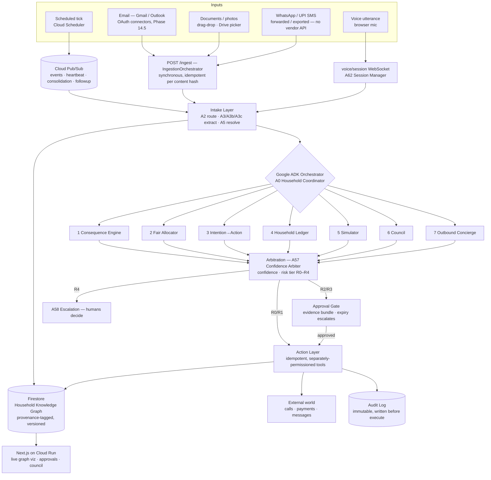

# System overview

Source: `GharOS_Build_Spec_v2.md` §6.1, `PHASES.md` §5.1. This is the top-level architecture diagram for the submission.

**Reading this diagram:** every inbound signal is normalised by the same intake layer and lands in one graph, but there are three entry *styles*, deliberately: Cloud Scheduler ticks and async events arrive through **Pub/Sub** and wake `gharos-api` with nobody present (this is the autonomy proof); on-demand ingestion ("scan my Gmail") is a **synchronous `POST /ingest`** call into `IngestionOrchestrator` (Phase 14.5), idempotent per `compute_content_hash` so a re-scan writes nothing new; voice is a **WebSocket session**. The seven subsystems are reasoning consumers of the shared graph, not seven parallel products. **Arbitration (A57) is the single chokepoint between reasoning (Layer 3) and action (Layer 5)** — reasoning agents hold no action credentials; see `02-layers.md`.

**Mandatory-requirement anchors visible here:** Gemini 3.5+ via **Vertex AI** powers every reasoning agent (Flash/Pro-tier routed in `reasoning/model_router.py`); the **Google ADK** orchestrator (`A0`) sequences the subsystems with tool isolation and approval-gate callbacks; **Cloud Run + Firestore + Pub/Sub + Cloud Scheduler** are the running infrastructure. Deploy topology is `06-deployment.md`; proof is `docs/DEPLOYMENT_PROOF.md`.
