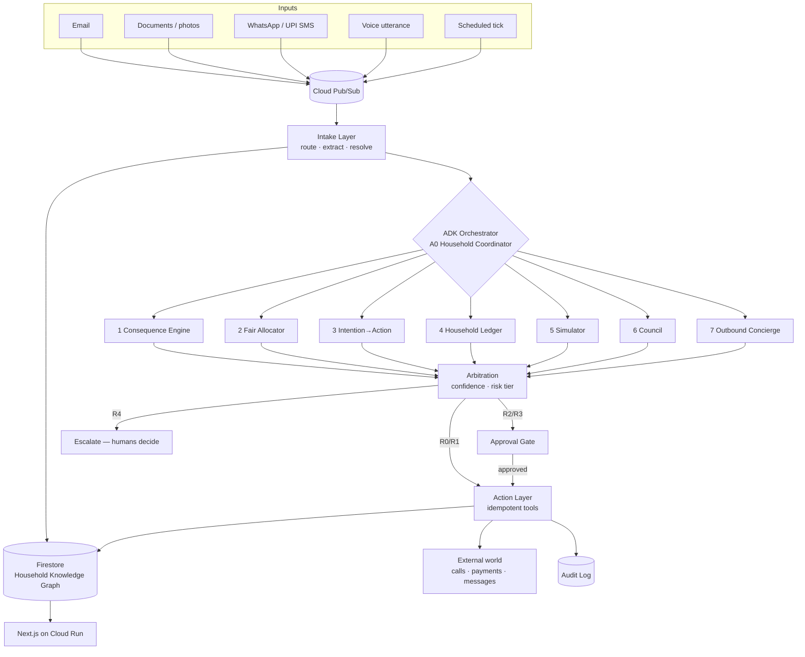

# System overview

Source: `GharOS_Build_Spec_v2.md` §6.1, `PHASES.md` §5.1.

**Reading this diagram:** every inbound signal — regardless of channel — enters through the same Pub/Sub topic and the same intake layer. There is one pipeline, not seven parallel ones; the seven subsystems are reasoning consumers of the same graph, not separate products. Arbitration is the single chokepoint between reasoning (Layer 3) and action (Layer 5) — see `02-layers.md`.
