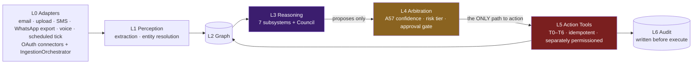

# Layers and the action barrier

Source: `GharOS_Build_Spec_v2.md` §6.2, `PHASES.md` §5.2.

**The L3→L5 barrier is the architecture.** Reasoning agents hold no action credentials. This is safety invariant #1 (no agent that reasons about money holds a financial tool credential) generalised to every subsystem: extraction agents cannot write the graph directly (that is A7 Graph Builder's job), reconciliation cannot pay, drafting cannot send, ranking cannot call, voice classification cannot approve. Every arrow crossing L3→L4→L5 is a proposal being evaluated, never a direct effect. Enforced structurally and tested — `ToolRegistry` refuses a gated-tier tool to an agent-side registrant (`test_tool_registry.py`); AST import-boundary scans prove no agent module imports `app.arbitration` / the connectors / Secret Manager (`test_voice_agents_arbitration_boundary.py`, `test_safety_invariants.py::TestPhase145IngestionCredentialAndSpeakerBoundary`).

- **L0 — Ingestion adapters.** Channel-specific, swappable (email, upload, SMS, WhatsApp export, voice, scheduled tick). Phase 14.5 added the Gmail/Outlook OAuth `SourceConnector`s and `pipelines/ingestion_orchestrator.py`, the single `POST /ingest` wire from raw payload to committed graph nodes. OAuth refresh tokens live in Secret Manager and never reach L3.
- **L1 — Perception.** Extraction (A3/A3b/A3c), entity resolution (A5). Writes SOURCE_DOCUMENT with provenance.
- **L2 — Graph.** The substrate. All reads and writes pass through it; every node/edge carries a provenance pointer and derivation tag or the repository write guard rejects it.
- **L3 — Reasoning.** The seven subsystems plus the Council. Read graph, propose changes. No direct external action.
- **L4 — Arbitration.** A57 Confidence Arbiter — confidence check, risk tiering (R0–R4), approval gating. The only path from proposal to action.
- **L5 — Action.** Tools that touch the outside world. Separately permissioned (T0–T6), idempotent per key, never fabricate success on failure.
- **L6 — Audit.** Immutable append, written before L5 executes (`write_before_execute`).
