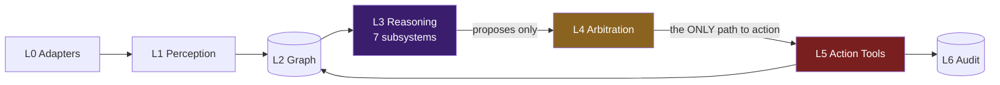

# Layers and the action barrier

Source: `GharOS_Build_Spec_v2.md` §6.2, `PHASES.md` §5.2.

**The L3→L5 barrier is the architecture.** Reasoning agents hold no action credentials. This is safety invariant #1 (no agent that reasons about money holds a financial tool credential) generalised to every subsystem: extraction agents cannot write the graph directly (that's A7 Graph Builder's job), reconciliation cannot pay, drafting cannot send, ranking cannot call. Every arrow crossing L3→L4→L5 is a proposal being evaluated, never a direct effect.

- **L0 — Ingestion adapters.** Channel-specific, swappable (email, upload, SMS, WhatsApp export, voice, scheduled tick).
- **L1 — Perception.** Extraction, entity resolution. Writes SOURCE_DOCUMENT.
- **L2 — Graph.** The substrate. All reads and writes pass through it.
- **L3 — Reasoning.** The seven subsystems. Read graph, propose changes. No direct external action.
- **L4 — Arbitration.** Confidence, risk tiering, approval gating.
- **L5 — Action.** Tools that touch the outside world. Separately permissioned. Idempotent.
- **L6 — Audit.** Immutable record, written before L5 executes.
