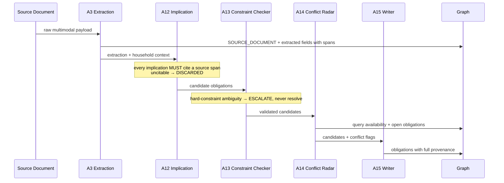

# Consequence Engine pipeline

Source: `GharOS_Build_Spec_v2.md` §7.3, `PHASES.md` §5.3.

**Reading this diagram:** extraction (A3) and implication (A12) are deliberately separate agents — mixing them would launder a hallucinated inference as an "extracted" fact, and the separation is proven by test at Gate 3. Every candidate obligation A12 produces must trace to a specific source span or it is discarded before it ever reaches the Constraint Checker (`citation_validator.py`; the honest recall/hallucination/citation-validity numbers are in `docs/IMPLICATION_BASELINE.md`). A13 never resolves a hard-constraint ambiguity itself; ambiguity is a first-class outcome that escalates. A16 Constraint Learner runs alongside this pipeline on repeated signals, proposing new constraints that are always confirmation-gated — it never writes a hard constraint autonomously.
