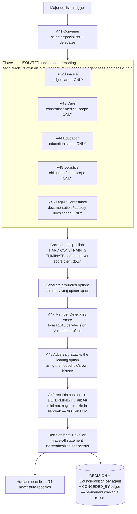

# Household Council protocol

Source: `GharOS_Build_Spec_v2.md` §12.2–12.3, `PHASES.md` §5.4, `docs/adr/019-household-council-contracts.md`.

**Reading this diagram — read `GharOS_Build_Spec_v2.md` §12.2 before implementing anything here.** This is not multi-agent debate. Every agent in Phase 1 queries a *different, structurally disjoint subgraph* through its own `ScopedGraphReader` (ADR-019: five non-overlapping domain scopes — Finance, Care, Education, Logistics, Legal) and reports *before seeing any other agent's output* — that isolation is what prevents conformity bias, and it is a registration-level tested constraint, not a convention (`test_council_specialist_scope_boundaries.py`, `test_council_structural_invariants.py`). No two council agents share both tool access and objective. Care and Legal contribute **hard constraints that eliminate options**, they do not score. The mechanism arbiter is deterministic code — minimax-regret with leximin tiebreaking (Savage 1951), chosen over Nash welfare / a utilitarian sum because the system never established cross-person cardinal utility comparability (same literature-honesty discipline as ADR-014). It never synthesizes a consensus. The word "debate" appears nowhere in this design, in code, comments, prompts, or UI — enforced repo-wide by safety invariant 6's grep test.
