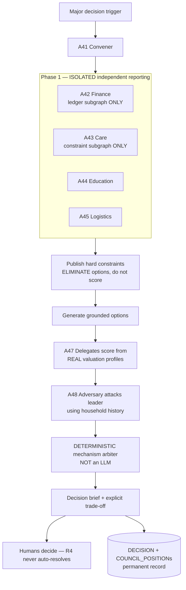

# Household Council protocol

Source: `GharOS_Build_Spec_v2.md` §12.3, `PHASES.md` §5.4.

**Reading this diagram — read `GharOS_Build_Spec_v2.md` §12.2 before implementing anything here.** This is not multi-agent debate. Every agent in Phase 1 queries a *different subgraph* and reports *before seeing any other agent's output* — that isolation is what prevents conformity bias, and it is a structural design constraint, not a convention. The mechanism arbiter that resolves Phase 6 is deterministic code, never an LLM synthesizing a consensus. The word "debate" must not appear anywhere this diagram's design is discussed, in code, comments, or UI.
