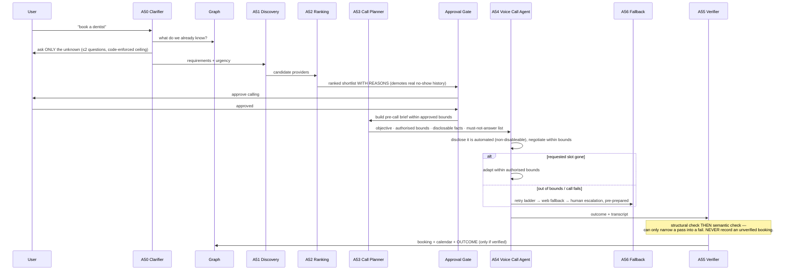

# Outbound Concierge

Source: `GharOS_Build_Spec_v2.md` §13.2-13.3, `PHASES.md` §5.5, `docs/adr/016-outbound-concierge-scope.md`.

**Reading this diagram:** the clarifier is graph-first — it asks only what the graph genuinely cannot answer, which is what keeps the demo's clarifying step to two questions instead of twenty (the ≤2 ceiling is enforced in code, not prompted). A53 copies the approved bounds verbatim and cannot widen them. The Approval Gate sits before any call is placed (R2) and again before money changes hands if the booking has a deposit (R3). The verifier (A55) is a hard gate on writing to the graph: a two-layer structural-then-semantic check that can only turn a pass into a fail, never the reverse — a call that "sounds like" it succeeded is not the same as a call cross-checked against what was requested, and only the latter is ever recorded.

**Demo honesty (ADR-016):** the counterparty in the demo is a **sandboxed, independently-reasoning LLM persona**, never a real phone call to a real business. Bounds enforcement, the mandatory automated-disclosure turn, the slot-gone adaptation, and verification-before-recording are all fully real. Synthesized *audio* is produced by the separate Phase 13 voice channel (Gemini native TTS); the concierge conversation itself is a real multi-turn text/transcript exchange.
