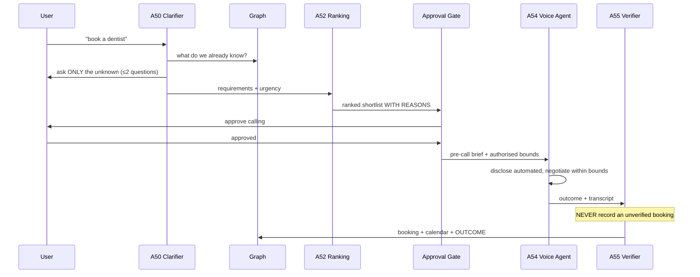

# Outbound Concierge

Source: `GharOS_Build_Spec_v2.md` §13.2-13.3, `PHASES.md` §5.5.

**Reading this diagram:** the clarifier is graph-first — it asks only what the graph genuinely cannot answer, which is what keeps the demo's clarifying step to two questions instead of twenty. The Approval Gate sits before any call is placed (R2) and again implicitly before money changes hands if the booking has a deposit (R3). The verifier is a hard gate on writing to the graph: a call that "sounds like" it succeeded is not the same as a call that was cross-checked against what was requested, and only the latter is ever recorded as a booking.
