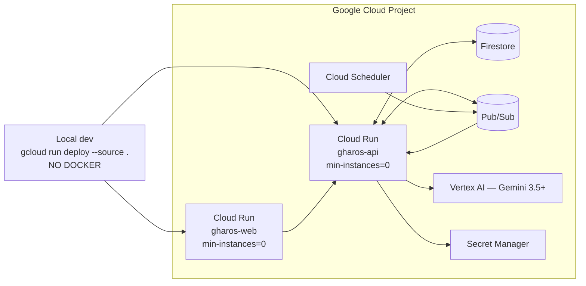

# Deployment

Source: `GharOS_Build_Spec_v2.md` §21.3, `PHASES.md` §5.6.

**Reading this diagram:** both Cloud Run services deploy from source via buildpacks — there is no Dockerfile anywhere in this repository, and its absence is a gate item at Phase 2 and Phase 15. `min-instances=0` on both services is what keeps the system scale-to-zero and defensible on cost; it is never overridden. Cloud Scheduler is what proves the system runs unattended — it publishes to Pub/Sub, which wakes `gharos-api` with no human present, and that unattended overnight run's real Cloud Logging timestamps are one of the strongest artifacts in `docs/DEPLOYMENT_PROOF.md`.
