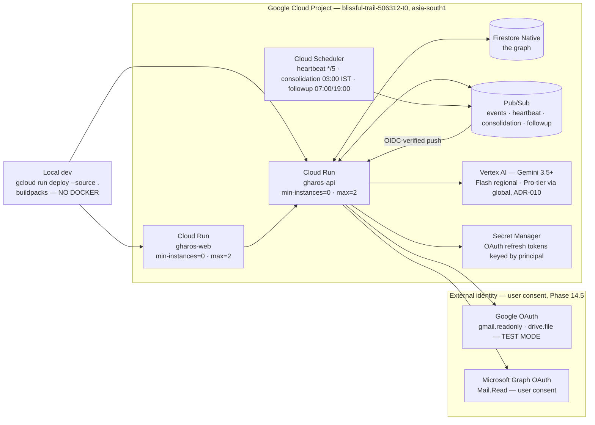

# Deployment

Source: `GharOS_Build_Spec_v2.md` §21.3, `PHASES.md` §5.6, `docs/DEPLOYMENT_PROOF.md`.

**Reading this diagram:** both Cloud Run services deploy from source via buildpacks — there is no Dockerfile anywhere in this repository, and its absence is a gate item at Phase 2 and Phase 15 (`find . -iname "Dockerfile*"` is empty). `min-instances=0` on both services keeps the system scale-to-zero and defensible on cost; it is never overridden (`infra/teardown.sh` re-asserts it after every proof capture). Cloud Scheduler is what proves the system runs unattended — it publishes to Pub/Sub, which wakes `gharos-api` via an OIDC-verified push with no human present. Three scheduled jobs run: the 5-minute heartbeat (Phase 2), nightly memory consolidation at 03:00 IST (Phase 14), and the twice-daily follow-up sweep (Phase 7). That unattended run's real Cloud Logging timestamps are the single strongest artifact in `docs/DEPLOYMENT_PROOF.md`. The Phase 14.5 OAuth connectors reach Google / Microsoft only with an explicit user grant; the refresh tokens they return live in Secret Manager, never in Firestore, never in an agent input.
